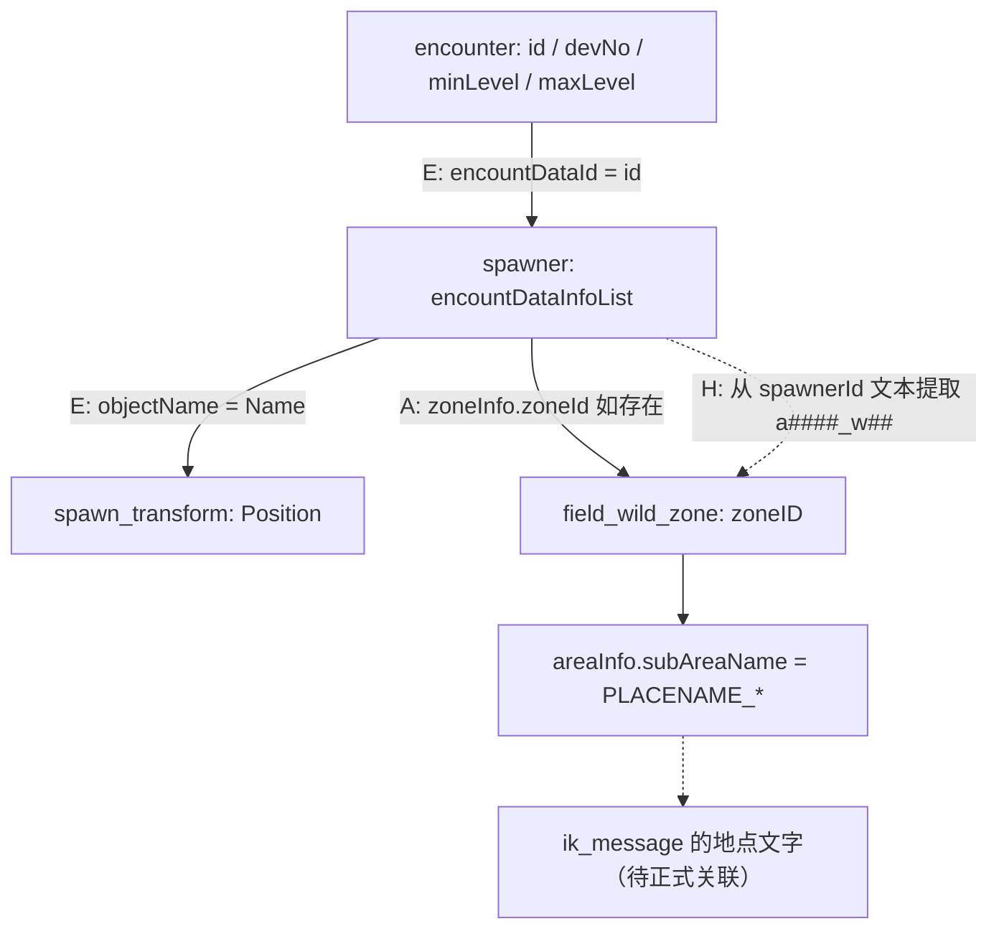

# 生成器、遭遇与坐标：怎么从三张表找到一只宝可梦

## 01. 先分清两个东西：遭遇定义 ≠ 生成器

- **Encounter**（遭遇参数）说明“可以生成什么配置”：`devNo`、等级、可能的头目附加参数、性格/个体设定、招式与掉落。它本身**不负责指定世界坐标**。
- **Spawner**（生成器）说明“这个场景对象何时、如何调用某条遭遇配置”：`encountDataInfoList[].encountDataId`、`weight`、`maxCount`、刷新条件、对象名和时间设置。
- **Transform**（变换）说明“这个对象放在哪里”：`Name`、`Position.X/Y/Z`、`Rotation`。
- **Zone**（区域）说明“场景/野生区的业务标识和展示键”：`zoneID`、`areaInfo.areaName`、`subAreaName` 等。

`encounter.records.csv`（13 行）→ 1,966 条遭遇；`spawner.records.csv`（13 行）→ 2,211 个生成器；`spawn_transform.records.csv`（86 行）→ 合计 2,108 条 transform 记录。每张 `*.records.csv` 是**顶层容器**，不要简单依行数判断资源数量。

## 02. 实际连接链条



**E**＝文件中实际字符串严格相等并通过校验；**A**＝原始表明确写出字段，但只对该条记录有效；**H**＝命名启发式推断，需谨慎。上图中的 `a####_w##` 是正则格式示意，不是十六进制地址。

## 03. 这张 JOIN CSV 的 16 个字段

[完整表](https://github.com/969981/ZA_Resources/blob/docs/za-v2.0.2-obsidian-extraction/Unpack/v2.0.2/romfs/arc/data.trpfs/virtual_converted/_tables/encounters/ZA_spawner_encounter_join.csv) · [前 100 行](https://github.com/969981/ZA_Resources/blob/docs/za-v2.0.2-obsidian-extraction/Unpack/v2.0.2/romfs/arc/data.trpfs/virtual_converted/_tables/encounters/ZA_spawner_encounter_join.preview.csv)

| 列名 | 正确读法 |
| --- | --- |
| `spawnerId` | 生成器自身的唯一 ID；一个生成器可能引用多条遭遇 |
| `encounterId` | 其引用的遭遇 ID（真正由 `encountDataId` 提供） |
| `speciesId` | 从关联成功的遭遇表取 `devNo` |
| `formNo` | 配置内形态编号，空值不等于已证实的默认 0 |
| `minLevel/maxLevel` | 静态遭遇等级范围，未额外计算头目等级 |
| `oyabunProbabilityRaw` | 遭遇定义里的头目原始字段数值 |
| `oyabunAdditionalLevelRaw` | 遭遇定义里的头目附加等级原始数值 |
| `encounterWeightRaw` | `encountDataInfoList[].weight`；**权重**不等于未经条件处理的全局概率 |
| `maxCount` | `encountDataInfoList[].maxCount`；该候选配置的计数参数 |
| `zoneIdInferredFromSpawnerName` | **从名字用正则提取出来的猜测**，不是真实 `zoneInfo.zoneId` 的导出 |
| `zoneNameInferred` | 用上面的猜测在 zone 表里查到的 `areaName` |
| `spawnPositionsJson` | 当前 spawner 所有 `appearanceSpawnerObjectInfoList` 位置引用的 JSON 数组 |
| `activationConditionJson` | **当前候选遭遇条目**的激活条件，另外还存在 spawner 顶层激活条件 |
| `refMatch` | `1` 代表这条遭遇引用找到了合法目标；不是出现状态 |
| `zoneMatchingMethod` | `id_regex_heuristic` 或 `unknown`，前者明确是名字推导 |

> [!important] 关于 zone 字段的一项重要发现
> 在 `spawner.json.gz` 的 `appearanceSpawnerObjectInfoList[].zoneInfo.zoneId` 中，**348 个生成器明确具有真实 zoneId 字段**。但是当前 `ZA_spawner_encounter_join.csv` 的列 `zoneIdInferredFromSpawnerName` **只使用名称正则推断**，并没有读取这个直接字段。整张表 3,268 行 JOIN 记录中仅 623 行具备这个推断 zone。**目前不能把表内的所有 zone 列都视为源外键**。想核查某个具体生成器，请打开原始 `spawner.json.gz` 或 `spawner.records.csv` 检查 `zoneInfo`。

## 04. 一条真实完整追踪

以 `id_spn_a0201_w01_v01_001_A` 为例：

1. 在生成器原始数据 `id` 中找到 `id_spn_a0201_w01_v01_001_A`。
2. 其 `encountDataInfoList[0].encountDataId` = `ect_a0201_w01_v01_z460_Alpha`。
3. 遭遇数据 `id` 精确匹配同一个字符串，`devNo=460`，`minLevel=33`，`maxLevel=35`，`oyabunProbability=100.0`，`oyabunAdditionalLevel=10`。
4. 生成器的 `appearanceSpawnerObjectInfoList[0].objectName` = `spn_a0201_w01_v01_001`，且它有**真实** `zoneInfo.zoneId=a0201_w01`。
5. 在坐标源数据中，`Name=spn_a0201_w01_v01_001` 精确匹配，读取：`X=-406.9212036`、`Y=-1.2605963`、`Z=-831.6444702`，以及 `Rotation.Y≈-90.195`。
6. 区域表 `zoneID=a0201_w01` 给出区域元数据。想显示中文地点还需读取并验证 `ik_message` 的 `PLACENAME` 对应键。

这条链的 ID、名字、数值来自真实数据。`Alpha` 是源 ID 的文本特征；**还不能因此断言游戏内是否一定头目、最终等级直接加 10 或某时刻必定能遇到**。

## 05. Spawner 源字段还有很多 JOIN 表没有展开

原始样本还包括：

```json
{
  "id": "id_spn_a0201_w01_v01_001_A",
  "coolTimeInfo": {"condition": 2, "time": 300.0},
  "appearanceSpawnerObjectInfoList": [
    {
      "objectName": "spn_a0201_w01_v01_001",
      "createScenePath": "t1_wild_a0201_w01_pokemon_object",
      "zoneInfo": {"zoneId": "a0201_w01"},
      "appearanceInfo": {"minCount": 1, "maxCount": 1}
    }
  ],
  "encountDataInfoList": [
    {
      "encountDataId": "ect_a0201_w01_v01_z460_Alpha",
      "weight": 100,
      "maxCount": 1,
      "repopProbability": {"afterCaptured": 100, "afterDefeated": 100}
    }
  ]
}
```

- `coolTimeInfo.time=300.0`：静态时间数值；未确认是否以秒计算以及如何触发。
- `repopProbability`：有“捕获后/击败后”字段名，但具体是否 100% 概率重置及何时检查仍需跟踪。
- `appearanceInfo` 和 `encountDataInfoList.maxCount` 是**不同层级**的计数参数，不宜等同。
- `tagList`、`additionalFlagList`、`showMapIcon` 等未在扁平 CSV 展示；要看原始 JSON。
- `activationCondition` 可同时位于顶层和候选项，必须分别判断。

## 06. 坐标 CSV 的七列

[ZA_spawn_points.csv](https://github.com/969981/ZA_Resources/blob/docs/za-v2.0.2-obsidian-extraction/Unpack/v2.0.2/romfs/arc/data.trpfs/virtual_converted/_tables/maps/ZA_spawn_points.csv)

| 列 | 说明 |
| --- | --- |
| `spawnerId` | 生成器键 |
| `objectName` | 生成对象名，试图关联 transform 的 `Name` |
| `matchedTransform` | 名称是否命中 transform（`1`/`0`） |
| `x/y/z` | 源 `Position.X/Y/Z`：三维空间坐标，不是内存地址或游戏地图格子 |
| `rotationJson` | 原始旋转分量，可能是 `{}` 或只有 `Y` |

本轮 **2,226** 条位置对象引用，**1,302** 条名称匹配，**924** 条未匹配。`matchedTransform=1` 但坐标列为空的记录也存在，可能因 FlatBuffers **默认零值未序列化**、原始对象字段缺省或源结构不同，不能把“空值”直接判断成“坐标无效”；对这种记录需查看完整 JSON/schema。

> [!warning] 不是地图路线
> `x=-406.921`、`y=-1.261`、`z=-831.644` 是模型/场景空间数值。进入场景的局部坐标、旋转、父对象以及地图单位可能影响最终世界位置，必须结合资源场景与游戏实测。

## 07. 找不到对应坐标怎么办

先搜索 `ZA_spawn_points.csv` 的 `objectName`。若 `matchedTransform=0`，检查：
- 原始生成器 `createScenePath` 和 `zoneInfo`；
- Transform 库是否只覆盖了某一类场景；
- 物体是否通过事件、父节点、脚本或运行时复制动态创建；
- 原始资源是否还未完成二次语义转换。参阅 [[01-资源树与证据等级]]。

**不要**将 `matchedTransform=0` 直接标记为“游戏中不存在”。

## 下一步

- [[17-地图区域与触发条件]]：`activationCondition` 中的旗标、phase、scene。
- [[19-实操查询与案例]]：怎样按 spawnerId、物种 ID 做 CSV 检索。
- [[13-遭遇表逐列解读]]：头目与个体参数的源表值。
