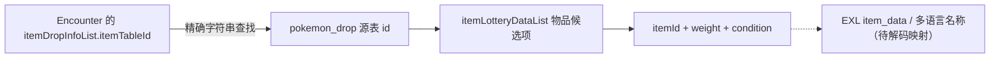

# 道具、掉落、商店和图鉴：哪些是实值、哪些只是结构

## 01. 先理解两种完全不同的数据质量

**A：配套有 .bfbs 的表**，能得到有字段名的实际 JSON，例如 `pokemon_drop_item_table_data_array.bin` 和 `item_ball_item_data_array.bin`。`ZA_item_lottery.csv` 就来自这一类。

**B：没有对应已确认 .bfbs 的 EXL 主表**，只能读取 FlatBuffers 根向量、vtable 和每个字段槽位的原始字节；如 `pokedex_contents_data.bin` 和 `item_data.bin`。`EXL_*_raw.csv` 属于这一类，不能根据 `field_0` 直接命名字段。

## 02. 物品掉落 CSV 的 7 列

[ZA_item_lottery.csv](https://github.com/969981/ZA_Resources/blob/docs/za-v2.0.2-obsidian-extraction/Unpack/v2.0.2/romfs/arc/data.trpfs/virtual_converted/_tables/items/ZA_item_lottery.csv)

| 字段 | 正确读法 |
| --- | --- |
| `sourceType` | `pokemon_drop`（宝可梦掉落相关表）或 `field_item_ball`（地图道具球表） |
| `tableId` | 掉落/物品球源表的 `id`，如 `drop_item_table_oyabun_01` |
| `entryIndex` | 表内第几个抽选项（从 0 开始），不是全局道具 ID |
| `itemId` | 表中的原始道具编号，尚未通过道具名称表核验 |
| `maxCount` | 当前抽选项的数量上界相关字段 |
| `weightRaw` | 抽选的原始权重，**不直接当作百分比** |
| `conditionJson` | `activationCondition` 等条件组成的 JSON |

当前共 **459 行**抽选项，其中 `sourceType=pokemon_drop` 为 **88** 行，`field_item_ball` 为 **371** 行。它们来自不同用途，不能直接加总为“459 个唯一道具”。

## 03. 真实掉落例子

`tableId = drop_item_table_oyabun_01`：

| entryIndex | itemId | weightRaw | maxCount |
| ---: | ---: | ---: | ---: |
| 0 | 2558 | 20 | 2 |
| 1 | 1124 | 50 | 2 |
| 2 | 1125 | 30 | 2 |

这是三个不同的候选物品条目。即便三行权重相加等于 100，也**不能直接认定实际掉落率为 20%/50%/30%**，因为游戏可能先按掉落条件筛选、进行多次抽选、使用不同层级的概率或调用者附加规则。

另一个实际链接：`encounterId=ect_a0201_w01_v01_z460_Alpha` 的原始 `itemDropInfoList` 可见：

```json
[
  {
    "itemTableId": "drop_item_table_oyabun_41",
    "dropProbability": 100,
    "minCount": 3,
    "maxCount": 3,
    "dropConditionList": [2]
  }
]
```

这里可以形成一条候选链：



**注意：** `dropProbability` 是遭遇定义字段；`weightRaw` 是掉落表候选项字段，两者不是同一个概率阶段。当前 `ZA_item_lottery.csv` 只扁平化了抽选项，`dropConditionList` 需要继续看 encounter 原始 JSON。

## 04. EXL 原始字段探针五列

[图鉴结构 CSV](https://github.com/969981/ZA_Resources/blob/docs/za-v2.0.2-obsidian-extraction/Unpack/v2.0.2/romfs/arc/data.trpfs/virtual_converted/_tables/pokedex/EXL_pokedex_raw.csv) · [道具结构 CSV](https://github.com/969981/ZA_Resources/blob/docs/za-v2.0.2-obsidian-extraction/Unpack/v2.0.2/romfs/arc/data.trpfs/virtual_converted/_tables/items/EXL_items_raw.csv)

| 列名 | 如何理解 |
| --- | --- |
| `recordIndex` | 根向量中的记录序号（0 起），**不等于全国图鉴号** |
| `tableOffset` | 这条记录在 **.bin 文件内**的字节位置 |
| `vtableOffset` | FlatBuffers vtable 在文件内的字节位置 |
| `objectBytes` | 当前 Table 本体的大小，不等于完整带引用的对象长度 |
| `presentFieldsJson` | 每个原始 field 槽号、对象内偏移和 `rawHex` 原始字节串 |

典型 `presentFieldsJson` 形态：

```json
{
  "0": {"offsetInObject": 4, "rawHex": "0100000001000000"},
  "1": {"offsetInObject": 8, "rawHex": "01000000"}
}
```

`rawHex` 按**磁盘原始字节**保存，小端模式下 `01000000` 可以被解释为 32 位整数 1，但**字段真实类型仍未知**；一个四字节槽也可能是布尔、枚举、偏移指针或其他内存布局的一部分。`rawHex` 最多取相邻 8 字节，可能包含下一个字段的字节，**不能把这 8 字节整体理解为一个值**。

> [!warning] 特别容易误解的 4 个“数量”
> `EXL_pokedex_raw.csv=364` 行、`EXL_dex_distribution_raw.csv=396` 行、`EXL_items_raw.csv=535` 行、`EXL_shops_raw.csv=6` 行：这些仅是**根向量的记录数**，不是已确认的图鉴物种数量、不同道具数量、商店 NPC 数量。结构读取的成功等级是 `STRUCTURE_ONLY`。

## 05. 一张图鉴记录应该怎样做逐字段研究

1. 从 `EXL_pokedex_raw.csv` 拿到 `recordIndex/tableOffset/vtableOffset`。
2. 在原始 `pokedex_contents_data.bin` 的这些位置查看字节，并依据 `vtableOffset` 找实际有值的 field 槽位。
3. 同时检查 `pokedex_sp_distribution_data` 和多语言图鉴文本键，比较可能属于相同物种/形态的记录；**不要先按数组顺序直接相等关联**。
4. 如果找到真正的 FlatBuffers `.fbs/.bfbs` 或反编译函数中的访问偏移，再映射 `field 0/1/2...` 为业务字段。
5. 对应关系可通过多个物种、不同形态、边界值交叉测试，最后才把字段名写到正式表。

目前可以记录“第 0 行 field 0 的十六进制值”，不应记录成“全国图鉴 1 / 妙蛙种子”等未经证实的结论。

## 06. 道具、技能和名称对照的正确路线

源数据里已经出现 `itemId=2558` 等数值，**要翻译成游戏中的中文名称**，应分析 `ik_message/dat/Simp_Chinese/common/itemname.dat` 和配套 `itemname.tbl` 的键与索引，并从 ROM 的道具 ID→文本索引引用确认对应关系。不能只因为一个外部数据库有同号物品，就假设本版本同一编号。

图鉴同理：`monsname`、`pokedex`、`zukan_comment_A/B` 的文字表只有文本，不自动证明它们在 `EXL` 二进制表中的主键。

招式同理：`wazaname`、`wazainfo` 的名称键需要与原始 `wazaId` 联通。只有当索引规则经过验证，才可以把“数字”替换为中文技能。

## 07. 文件位置和工具

完整原始 EXL 数据：
- `world/exl/pokedex_contents_data/pokedex_contents_data/pokedex_contents_data.bin`
- `world/exl/pokedex_sp_distribution_data/pokedex_sp_distribution_data/pokedex_sp_distribution_data.bin`
- `world/exl/item_data/item_data/item_data.bin`
- `world/exl/shop/shop_item_lineup/shop_item_lineup.bin`

使用 `scripts/Probe-ZA-RawEXL.py` 产出 `EXL_*_raw.csv`；使用 `Export-ZA-Databases.py` 对有 `.bfbs` 的掉落和属性数据做字段解析，详细命令见 [[18-导出复现与验收]]。
