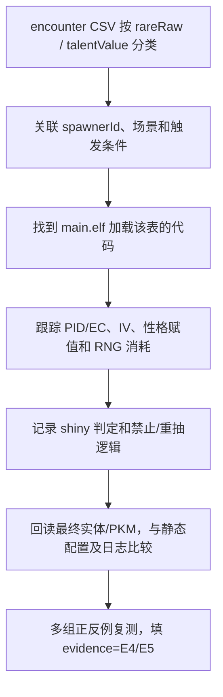

# 怎么用现有 CSV 真正研究锁闪、固定 IV 和 RNG

**前提：** 已有 1,966 条遭遇的 `rareRaw`、`minLevel`、`maxLevel`、六项 `talentValue` 和若干 `oyabunProbability`、预置 `wazaList`，但这些只是**原始静态配置**。生成过程中可能再经过 PID/EC、RNG 调用、难度调整、剧情条件与实体实例化。

## 01. 已经能确定的字段

| 来源 | 字段 | 已看见的具体数值 | 结论边界 |
| --- | --- | --- | --- |
| `encounter` | `rare` | 536870911、805306367、1073741823 | 还不能翻译成锁闪或闪率 |
| `encounter` | `talentValue.hp/atk/def/spAtk/spDef/agi` | -1、31 等 | 能确定**配置值**，不能确定最终生成的 IV |
| `encounter` | `talentVNum` | 某些配置有 3 | 最低几 V / 固定几 V 尚需代码 |
| `encounter` | `seikaku` | -1 等 | 性格候选字段，枚举语义待查 |
| `encounter` | `tokusei` | 255 | 特性字段，可能为占位候选 |
| `trainer` | `poke*.rareType` | 1、2 | 训练家专用原始枚举，不能和 encounter rare 混同 |
| `oyabun_setting` | `MaxTalentValueCount` | 3 | 静态设定，具体运行时算法待核 |
| `oyabun_setting` | `StrengthenValue` | 20 | 不是已确认的 IV 增益百分比 |

## 02. 有意义的对照组

**A：事件/剧情样本** `ect_boss_0359_01`
- `devNo=359`，`minLevel=maxLevel=25`；
- 六项 `talentValue=31`；
- `rare=536870911`；
- 对比 `btl_ect_boss_0359_01` 等相关记录时，记录形态差异与调用场景。

**B：野生区头目候选** `ect_a0201_w01_v01_z460_Alpha`
- `devNo=460`、`minLevel=33`、`maxLevel=35`；
- `oyabunProbability=100.0`、`oyabunAdditionalLevel=10`；
- 六项 `talentValue=-1`，`rare=1073741823`；
- 已有直接 spawner 外键和空间位置，适合游戏内重复采样。

**C：同区普通候选** `ect_a0201_w01_v01_z361`
- `devNo=361`、`minLevel=32`、`maxLevel=34`；
- `oyabunProbability=5.0`；
- `activationCondition` 中有 `momiji_wild_zone_condition` 原始字符串；
- 对照 B 看不同分支是否走相同生成函数。

这三组只能提出实验假设，不能通过数值大小关系证明 A 锁闪、B 能闪或 C 头目率恰好 5%。

## 03. 研究流程（由静态到动态）



第一阶段可以在 CSV 中按 `rareRaw` 分组，分析哪类 `encounterId`、`talentValue`、`oyabunProbability` 共现。第二阶段按 `spawnerId` 找真实场景和刷新条件，**不要在未满足条件时做有限次数抽样，然后宣布“锁闪”**。第三阶段用匹配的 `main.elf` Build ID 断点或日志证实最终生成的 PID/EC/IV/闪光判定。

## 04. 如何判断一个结论“已经闭合”

| 问题 | 仅有 CSV 能否回答 | 最低进一步证据 |
| --- | --- | --- |
| 配置中哪六项 IV 显式给了 31？ | 能 | 源 Schema 和记录数值（E2） |
| `talentValue=-1` 是否随机 IV？ | 不能 | 生成函数如何处理 -1（E4） |
| `rareRaw` 是否限制闪光？ | 不能 | 读取它的代码分支、PID 判定调用（E4） |
| 训练家 `rareType=2` 是否闪光？ | 不能 | enum 定义或最终实例比较（E4） |
| `oyabunAdditionalLevel=10` 是否直接加到等级？ | 不能 | 最终等级赋值的计算步骤（E4） |
| 野生 Z-A 是否有静态固定 Seed？ | 不能 | RNG 初始化与状态传递链，按场景复测（E4/E5） |
| 某剧情对象是否永远不能闪？ | 不能 | 所有相关入口统一锁定逻辑和反例测试（E4/E5） |

## 05. 推荐的证据表结构

```csv
gameVersion,buildId,sourcePath,encounterId,spawnerId,speciesId,formNo,rareRaw,ivRaw,scenario,shinyLocked,pidFunctionRva,ivFunctionRva,shinyCheckRva,observedPid,observedEC,observedIVs,testCount,evidenceGrade,notes
2.0.2,,world/ik_data/field/pokemon/encount_data/encount_data/encount_data_array.bin,ect_a0201_w01_v01_z460_Alpha,id_spn_a0201_w01_v01_001_A,460,,1073741823,"-1/-1/-1/-1/-1/-1",wild_zone,unknown,,,,,,,0,E3,"静态外键已匹配，缺少运行时逻辑"
```

该 CSV 是**建议记录模板，不是已经在仓库导出的实测 PID 数据**。未验证的 `shinyLocked` 保持 `unknown`，`pidFunctionRva` 等字段留空。不要为了填表而伪造地址或 Seed。

## 06. 版本与地址

仓库 v2.0.2 的 `exefs/main/main.elf` 与 `exefs/exefs-manifest.json` 可用作 Build ID 核对；文件中的整数 ID、`tableOffset`、`world Position` 均不是 `main+RVA`。动态定位请遵循 [[07-ExeFS地址与动态验证]]，确保主机游戏 Build ID 与反汇编文件一致后才使用断点。

从 [[13-遭遇表逐列解读]]、[[14-生成器刷新与坐标]] 出发研究，遇到无法证实的机制及时回到 [[20-字段缺省值与证据级别]] 的证据等级表。
