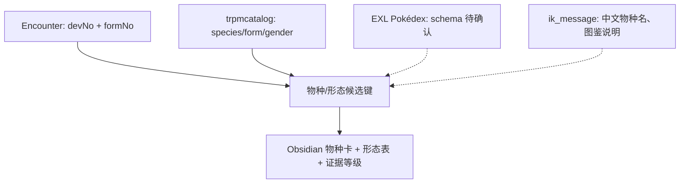

# Z-A v2.0.2 图鉴、物种和形态到底怎么对应

> [!important] 先记住最重要的一点
> **图鉴条目、游戏内部物种编号、模型资源条目、遭遇定义是四套不同概念。** 即使它们在简单物种上恰好能用同一个数字对上，也不能推导所有形态、Mega、剧情宝可梦都用同一规则。当前已生成 [[22-宝可梦数据档案索引|362 篇按 devNo 整理的档案]]，这是**遭遇表所涉及的物种编号集合**，不是“已验证完整 Z-A 图鉴 362 种”。

## 一、四种常见编号

| 名称 | 实际来源 | 实例 | 作用和局限 |
|---|---|---|---|
| `devNo` / `speciesId` | `encount_data_array.bin` | `460` | 一条遭遇定义希望使用的宝可梦物种编号 |
| `formNo` | 同上 | `1`、`2` 或字段缺省 | 资源对应的形态编号；未显式存在不意味着已经证实为 0 |
| `encounterId` | `encount_data_array.bin` | `ect_a0201_w01_v01_z460_Alpha` | 一条具体**遭遇配置**；同一物种可有很多条 |
| `spawnerId` | `pokemon_spawner_data_array.bin` | `id_spn_a0201_w01_v01_001_A` | 场景中使用遭遇配置的**刷新器** |
| `recordIndex` | `EXL_pokedex_raw.csv` | `0`、`1` | FlatBuffers 向量顺序，不是已证明的官方图鉴号 |
| `SpeciesInfo` | `ik_pokemon/catalog/...trpmcatalog` | 物种、形态、性别与模型路径信息 | 主要是**资源目录**，不能替代图鉴内容表 |

完整生成物种页由 `scripts/Generate-ZA-PokemonObsidian.py` 编排，不会自动给未证实的中文名称或全国图鉴顺序。

## 二、不同数据表分别能回答什么？

| 原始文件/输出 | 目前数据量 | 已经能验证的内容 | 暂时不能回答 |
|---|---:|---|---|
| `ZA_encounters_flat.csv` | 1,966 配置 / 362 不同 devNo | 物种号、形态候选、等级、静态 IV/技能字段 | 是否属于正式图鉴、最终捕获率 |
| `EXL_pokedex_raw.csv` | 364 根记录 | 每条 table 的偏移、vtable、field slot 原始字节 | 各 field 的正式业务含义和中文图鉴名 |
| `EXL_dex_distribution_raw.csv` | 396 根记录 | 分布表物理记录与原始槽位 | 分区图鉴排序、编号及关联外键 |
| `pokemon_data_array.bin` | 3 组、802 内层数据 | 事件/NPC/测试用 Pokémon 原始参数 | 所有物种图鉴的完整属性集合 |
| `poke_resource_table.trpmcatalog` | 资源目录，非图鉴 | 资源对应物种、形态、材质/模型路径候选 | 是否可遇、是否可捕获 |

**364、396、362 互不等价**：不能据此写“游戏只有 362 只”“图鉴有 364 种”或“图鉴分布有 396 个宝可梦”。这些只是当前**不同来源**的记录数。

## 三、EXL 图鉴为何只有 field 0、field 1？

`EXL_pokedex_raw.csv` 的一行包含：

```text
recordIndex = 0
tableOffset = 6396
vtableOffset = 6388
objectBytes = 12
presentFieldsJson = {
  "0": {"offsetInObject":4,"rawHex":"0100000001000000"},
  "1": {"offsetInObject":8,"rawHex":"01000000"}
}
```

如何解释：

1. `recordIndex=0` 仅表示它是 root vector 第一个元素。
2. `tableOffset=6396` 是**这个 .bin 里的文件字节偏移**，与程序 `main+RVA` 无关。
3. `presentFieldsJson["0"]` 的 `rawHex` 是直接读出的磁盘字节；由于探针截取 8 字节，可能覆盖相邻字段，**不能把全部 8 字节当作一个有语义的 64 位值**。
4. `01000000` 小端解码“可能等于整数 1”，但还没确定字段类型、是否偏移、是否物种 ID。
5. 下一步应找到 `EXL` 业务 Schema 或主程序访问该 table 的字段偏移，之后再对照多条有明显形态差异的记录。

目前状态只有 **E1 结构级**，详见 [[20-字段缺省值与证据级别]]。

## 四、形态怎么研究，如何避免误判

真实遭遇表中 `formNo` 的序列化情况：

| formNo 原始值 | 遭遇配置记录数 |
|---|---:|
| 未显式写入 | 1,652 |
| 1 | 163 |
| 2 | 45 |
| 3 | 37 |
| 4 | 33 |
| 5 | 1 |
| 6 | 35 |

这里的 `1` 只是形态枚举原值，不保证它在所有宝可梦中统一表示 Mega、地区形态或其他形态。同一 `devNo` 下的 `formNo=1` 必须与对应物种模型资源和游戏实体校验。

建议建立以下关系：



实操时先按 `devNo` 查询 [[22-宝可梦数据档案索引]]；然后比较该物种不同 `formNo` 的遭遇与资源，再检查是否存在相同的 ID 被不同刷新器引用。不要按 `formNo` 在全部物种中跨种强行赋同一个形态名。

## 五、如何获得中文名称与图鉴文本

当前 ROM 资源里可找到：

- `ik_message/dat/Simp_Chinese/common/monsname.dat` + `monsname.tbl`：宝可梦名称候选资源。
- `pokedex.dat`、`zukan_comment_A.dat`、`zukan_comment_B.dat`：图鉴相关文本候选。
- 日文、繁中、英文、法德意西韩等语言也有 `ik_message/dat/{Language}/common/` 对应路径。

处理链应该是：解析消息 `.tbl` 键索引 → `.dat` 解码 → 证明该索引如何对应 `devNo+formNo` 或 Pokédex 业务键 → 输出中文与多语言名称列。**没有通过索引核验前，不应把外部百科按编号的名称直接灌进 ROM 解析结果。**

## 六、如何在 Obsidian 中组织正式图鉴

推荐目录：

```text
22-宝可梦数据档案索引.md
宝可梦档案/
  No-0001.md
  No-0460.md
  ...
23-图鉴与形态编号专题.md
```

每张自动生成的笔记都有 `speciesId`、遭遇/刷新/训练家关联、明确的 `pokedexMembership: unknown`、`shinyLocked: unknown`，便于你以后逐条用有证据的图鉴姓名填充。**切勿把 No-0460 当成第 460 号 Z-A 地区图鉴。**

## 七、推荐的图鉴解析验收标准

1. EXL 字段类型恢复，不再仅有 `fieldId/rawHex`。
2. 证明哪些是正式图鉴 `species/form` 键、哪些是图鉴内部排序键。
3. 用 `monsname/pokedex/zukan_comment` 完成中文版/英文版多语言双向校验。
4. 与 `trpmcatalog` 中模型的形态、性别资源做交叉抽查。
5. 用至少 3 类含多形态宝可梦测试，并记录无法按编号简单对齐的反例。
6. 最后再声明某条记录在 v2.0.2 的图鉴实际展示状态，避免把游戏资源中存在当成玩家可捕获或可登记。

相关：[[24-六项个体值与生成规则专题]] · [[25-遭遇区域等级与生成条件专题]] · [[26-招式与技能学习数据专题]]。
