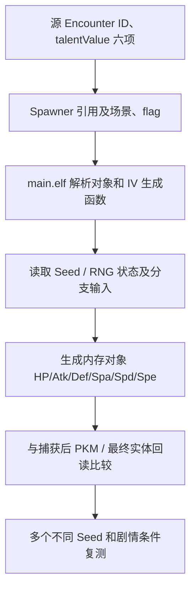

# Z-A 2.0.2 个体值解析：六项到底代表什么？

## 一、最核心的区分

> [!warning] 不能把静态值当成捕获后的实际个体
> `talentValue` 是游戏加载前的配置字段。`31` 代表该字段**显式指定为 31**；`-1` 是源表中的特殊数字，无法仅凭静态表证实它是“随机分配”“不指定”“继承”还是其他规则。真正生成的六项 IV 必须读游戏生成逻辑及最终 PKM/实体结构。

`ZA_encounters_flat.csv` 的六列：

| CSV 名 | 原始字段 | 常规统计顺序 |
|---|---|---|
| `ivHp` | `talentValue.hp` | HP |
| `ivAtk` | `talentValue.atk` | 攻击 |
| `ivDef` | `talentValue.def` | 防御 |
| `ivSpAtk` | `talentValue.spAtk` | 特攻 |
| `ivSpDef` | `talentValue.spDef` | 特防 |
| `ivAgi` | `talentValue.agi` | 速度 |

在 [[22-宝可梦数据档案索引|物种专属档案]] 中，用 `HP/Atk/Def/Spa/Spd/Spe` 顺序展示六项的**原始设置**，以 `∅` 记录源字段缺省。与 PKM 文件中常见的字节偏移顺序**不能混同**。

## 二、从 1,966 条真实遭遇配置统计

| 条件（对六项原始配置的判断） | 记录数 | 代表什么 |
|---|---:|---|
| 六项全部**显式等于 31** | **96** | 有显式六项全 31 的静态参数 |
| 六项全部**显式等于 -1** | **1,774** | 六项配置都写了 -1 |
| 至少一项为非空且不属于 {-1,31} | **69** | 还存在其他数值设置 |
| 全部记录数 | 1,966 | 各类型可能重叠、剩余有其他缺省组合 |

**注意：** 三个统计条件并非互斥分类的完整划分，不能简单用 1,966 减前三项推出“随机 27 条”；须逐条看其余混合或未显式存储字段。

## 三、实物示例：静态六项全 31

遭遇 `ect_boss_0359_01`（原始结构 `encounter.json.gz`）包含：

```json
{
  "id": "ect_boss_0359_01",
  "devNo": 359,
  "minLevel": 25,
  "maxLevel": 25,
  "talentValue": {
    "hp": 31, "atk": 31, "def": 31,
    "spAtk": 31, "spDef": 31, "agi": 31
  },
  "wazaList": {
    "waza1": 399, "waza2": 232,
    "waza3": 109, "waza4": 43
  }
}
```

该记录还含独立的 `strengthenValue.hp=220` 和其他项 `10`；这些是**另一个字段结构**，不可把 `strengthenValue` 当作额外 IV 或努力值。实体最终属性可能还有等级、性格、种族值、强化等不同因素。

目前只能写“该遇敌配置六项显式 31”，不能写“玩家抓到的每一只必然 6V”，除非确认游戏最终生成读取这一配置并不被其他机制覆盖。

## 四、野生头目候选：六项全 -1

`ect_a0201_w01_v01_z460_Alpha` 的实际记录：

- `devNo=460`，`minLevel=33`、`maxLevel=35`；
- `talentValue` 六项都是 `-1`；
- `oyabunProbability=100.0`；
- `oyabunAdditionalLevel=10`；
- `rareRaw=1073741823`。

可以提出待验证问题：加载这个配置时，`-1` 是否由 RNG 决定？是否另有头目保证几项 31 的逻辑？附加 10 是否作用到最终等级？目前**不能**凭 `MaxTalentValueCount=3` 或 `talentVNum=3` 就把这些推断写成确定规则。

## 五、`talentVNum`、`talentScale`、`oyabun_setting`

| 数据 | 示例 | 不确定点 |
|---|---|---|
| `talentVNum` | 某测试配置有 3 | 究竟是保证 V 数、处理次数还是生成器参数？ |
| `talentScale` | -1、128、255 | 该值的范围/精度/比例意义需查程序 |
| `MaxTalentValueCount` | 头目表 3 | 是否只在头目分支使用，如何影响实际 IV |
| `StrengthenValue` | 头目表 20 | 与 HP/攻击等属性/强化的真实关系 |
| `strengthenValue` | 剧情配置中有具体 HP/其他数值 | 不应混称 IV、基础种族值或努力值 |

## 六、性格、特性、性别的占位与枚举

- `natureRaw` 源 `seikaku`：有 `-1`、`3`、`8`、`17` 等不同整数；尚需类型枚举与最终性格比对。
- `abilityRaw` 源 `tokusei`：本轮遭遇数据中 1,966 条均为 `255`，不能理解成“1,966 条都是 255 号特性”。
- `sexRaw` 源 `sex`：可能出现 `-1` 等哨兵值，不能未经核对断定性别分布。
- 训练家 `natureRaw` 和 `rareTypeRaw` 属于训练家队伍对象的字段，不要机械等同遭遇对象的 `seikaku` 和 `rare`。
- 表中缺失的标志字段可能是 FlatBuffers 默认值省略，详见 [[20-字段缺省值与证据级别]]。

## 七、如果要验证“固定 3V / 6V / 随机”

推荐真实研究链：



一次实验至少记录 `gameBuildId`、`encounterId`、`spawnerId`、静态六项配置、游戏实际六项、RNG 状态、函数 `main+RVA` 和反例。**当前 Obsidian 自动档案只做到静态参数和外键，不包含编造的运行时断点地址。**

## 八、怎么查某物种所有显式 IV 配置

在 `ZA_encounters_flat.csv` 中按 `speciesId` 筛选，比较所有 `encounterId` 的 6 项 `iv*`。也可以用 Python：

```python
import csv
from pathlib import Path

root = Path("Unpack/v2.0.2/romfs/arc/data.trpfs/virtual_converted/_tables")
with (root / "encounters/ZA_encounters_flat.csv").open(
    encoding="utf-8-sig", newline=""
) as f:
    for row in csv.DictReader(f):
        if row["speciesId"] == "359":
            iv = [row[x] for x in (
                "ivHp", "ivAtk", "ivDef", "ivSpAtk", "ivSpDef", "ivAgi"
            )]
            print(row["encounterId"], row["minLevel"], row["maxLevel"], iv)
```

要避免把 “IV 六项中的空白” 直接转成 0。该查询只展示所有已解码的配置，不等于玩家可遇到的全部实例。

继续阅读：[[13-遭遇表逐列解读]] · [[21-锁闪与个体字段研究清单]] · [[26-招式与技能学习数据专题]]。
