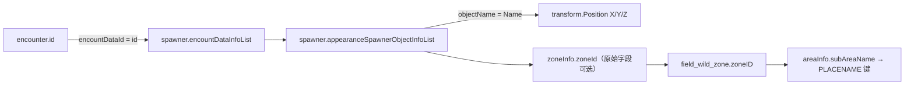

# 从某一只宝可梦追踪到地图：地点、等级、刷新规则

## 一、最容易搞错的三件事

1. **遭遇定义**不是地图上的实体：`encounter.id` 是一段可复用的参数，写有物种、形态、最低/最高等级等。
2. **Spawner** 是具体刷新器：一个 `spawner.id` 可能引用不同的 `encountDataId`；可有多个 `appearanceSpawnerObjectInfoList` 对象和激活条件。
3. **地点**有多种表示：野生区编号 `zoneId`、场景名 `createScenePath`、对象名 `objectName`、三维资源坐标 `Position`，不是简单的“地图第几号区域”。

基本链路：



实线只标示**已从数据结构读出的实际字段和可匹配键**，不代表运行时所有条件都成立。

## 二、你要看的三张关键 CSV

| 文件 | 记录数 | 适合查什么 |
|---|---:|---|
| `encounters/ZA_encounters_flat.csv` | 1,966 | `speciesId`/形态/最低和最高等级/预设个体/头目值 |
| `encounters/ZA_spawner_encounter_join.csv` | 3,268 | 某遭遇在**哪些生成器**中被引用、区域推断、权重 |
| `maps/ZA_spawn_points.csv` | 2,226 | 哪些生成器对象能解析出坐标及旋转 |
| `maps/ZA_zones.csv` | 20 | 区域 ID、名称键和快速旅行旗标 |

当前的连接对账：2,211 个生成器，有 3,268 次 `encountDataId → id` 引用，全部命中；2,226 条位置对象引用中有 1,302 条名称命中 Transform；其余 924 条只是当前**未按该名称方法匹配**，不意味着游戏里缺少坐标或资源。

## 三、真实示例：静态等级、区域与坐标

以下四组来自 `ZA_spawner_encounter_join.csv`，并非从外部攻略抄录。

| 生成器 ID 后缀 | encounterId | devNo | level min–max | oyabunProbability 原值 |
|---|---|---:|---|---:|
| `a0201_w01_v01_001_A` | `ect_a0201_w01_v01_z460_Alpha` | 460 | 33–35 | 100.0 |
| `a0201_w01_v01_011` | `ect_a0201_w01_v01_z361` | 361 | 32–34 | 5.0 |
| `a0201_w01_v01_021` | `ect_a0201_w01_v01_z459` | 459 | 32–33 | 5.0 |
| `a0201_w01_v01_031` | `ect_a0201_w01_v01_z582` | 582 | 35–36 | 5.0 |

上面 `a0201_w01` 字符串既在一些原始 `zoneInfo.zoneId` 中出现，也可从生成器名称中提取；**当前 JOIN CSV 的 `zoneIdInferredFromSpawnerName` 列采用的是名称推断**，不是原始 `zoneInfo` 字段。若需要确证某一生成器区域，应在 `spawner.records.csv` 或 `spawner.json.gz` 查它的 `zoneInfo`。

同组实物坐标（Transform）：

| objectName | X | Y | Z |
|---|---:|---:|---:|
| `spn_a0201_w01_v01_001` | -406.921 | -1.261 | -831.644 |
| `spn_a0201_w01_v01_011` | -437.292 | -0.809 | -830.186 |
| `spn_a0201_w01_v01_012` | -450.978 | -1.108 | -840.167 |

**这些是游戏场景资源坐标，不是内存地址或现实 GPS 经纬度**。是否已经应用场景原点/父对象变换、角色位置是否安全，需要在运行时核实。

## 四、什么叫等级 min/max，头目会不会加等级？

`minLevel=33`、`maxLevel=35` 是遭遇配置写的数字。`oyabunAdditionalLevel=10` 是另一个字段；游戏可能在生成时有条件地使用它。不能未经函数实测就写“所有 460 号头目最终都是 43–45 级”。

另外，同一物种在不同剧情阶段/地图可以出现不同 `minLevel/maxLevel`，因此 [[22-宝可梦数据档案索引|单物种卡片]] 的“跨配置等级包络”只展示这个物种在所有已提取配置中的最低和最高数字，**不是每个地点的合法等级范围**。实际地点的候选等级应看其具体 `encounterId` 那一行。

本轮静态遭遇表共有 1,966 条等级配置，`minLevel` 最小值 2、`maxLevel` 最大值 100，其中 287 条 `minLevel==maxLevel`。它们是源参数统计，**不能**直接据此给出野外最高等级或全游戏最高等级结论。

## 五、剧情旗标、phase 和刷新概率

生成器可能包含：

```json
{
  "id": "id_spn_d03_01_ev_001",
  "coolTimeInfo": {"condition": 2, "time": 10.0},
  "encountDataInfoList": [
    {
      "encountDataId": "ect_d03_01_z094_ev",
      "weight": 100,
      "maxCount": 1,
      "repopProbability": {
        "afterCaptured": 100,
        "afterDefeated": 100
      }
    }
  ]
}
```

此条的顶层还有 `activationCondition` 条件：`phase_condition`、`flag_condition`；Encounter 条目本身也可能有 `force_condition`。这至少是**两个层级的逻辑参数**。

| 字段 | 可以确定 | 不可以直接确定 |
|---|---|---|
| `phase_condition` | 用剧情阶段相关类别条件 | 数值一定等于具体章节 |
| `flag_condition` | 用命名的剧情/解锁 flag 条件 | `op=1/2` 的比较语义 |
| `coolTimeInfo.time` | 冷却时间相关原始数值 | 单位确定为秒以及何时重置 |
| `weight` | 某一级别的候选权重 | 最终遇敌几率就是它/100 |
| `repopProbability.afterCaptured` | 捕获后重刷配置原始数值 | 条件无关的捕获后 100% 重刷 |
| `maxCount` | 该配置计数参数 | 地图永远固定同时存在这么多只 |

天气、昼夜、故事解锁也应在其它关联表或运行时条件枚举中继续查，不能仅凭当前 CSV 没有显式 `weather` 列就认定不受天气/昼夜影响。

## 六、怎么按宝可梦编号实际查地点

```powershell
$base = "Unpack/v2.0.2/romfs/arc/data.trpfs/virtual_converted/_tables"
Import-Csv "$base/encounters/ZA_spawner_encounter_join.csv" |
  Where-Object { $_.speciesId -eq "460" } |
  Select-Object spawnerId, encounterId, minLevel, maxLevel,
                zoneIdInferredFromSpawnerName, oyabunProbabilityRaw |
  Format-Table -AutoSize

Import-Csv "$base/maps/ZA_spawn_points.csv" |
  Where-Object { $_.spawnerId -eq "id_spn_a0201_w01_v01_001_A" } |
  Select-Object objectName, matchedTransform, x, y, z
```

用 Obsidian 则直接打开 [[22-宝可梦数据档案索引]] → 选择对应 `No-0460` 卡片 → 查看“每条遭遇定义”和“对应生成器、区域与位置”两节。若想查的是实际中文地名，还得将 `PLACENAME` 信息与 Simplified Chinese 的消息资源关联。

## 七、地图与等级关联的后续正确工作

- 区域：优先为所有 spawner 导出原始 `zoneInfo.zoneId`，与名称启发式输出并排，分别标记匹配方法。
- 地点中文名：`field_wild_zone.areaInfo.subAreaName` → `ik_message.dat/tbl` 的候选键，须抽样验证。
- 等级/头目最终状态：用对应 Build ID 在实体生成前后监测属性变化，记录源码调用和输出。
- 野生区事件：将 `activationCondition` 嵌套条件树转为结构化表达式，仍需确认 `op`、AND/OR 的真实规则。
- 完整可捕获列表：动态事件、任务固定、脚本赠送等可能绕过普通 spawner，需要独立入口调查。

相关阅读：[[14-生成器刷新与坐标]] · [[17-地图区域与触发条件]] · [[23-图鉴与形态编号专题]]。
