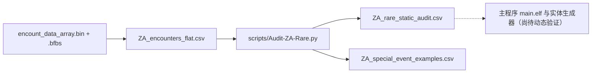

# Z-A 2.0.2 锁闪研究：从真正的 rare 原始值开始

> [!danger] 当前证据边界
> 这里实际解析了 1,966 条 Encounter 的原始 `rare` 数值及部分固定剧情样本；**这不等于找到了 Z-A v2.0.2 主程序的锁闪分支**。没有本机验证的 `main+RVA`、最终 PID 过滤函数或重抽机制，本档案绝不将 `rareRaw` 直接写成 `shinyLocked=true/false`。

## 一、数据来源与结果

原始文件：`world/ik_data/field/pokemon/encount_data/encount_data/encount_data_array.bin` 及配套 BFBS。解析路径：



通过 `rareRaw` 的十六进制表示发现三个不同组：

| rareRaw 十进制 | 十六进制 | 数量 | 文本特征示例 |
|---:|---|---:|---|
| 536870911 | `0x1FFFFFFF` | **281** | `ect_boss_*`、`sub_*`、`m10_x`、`m10_y` |
| 805306367 | `0x2FFFFFFF` | **1** | `ect_a0102_w01_v01_z179_Qst074` |
| 1073741823 | `0x3FFFFFFF` | **1,684** | 众多野生区 `ect_a*` 和 `ect_zdm_*` |

三个数值的最低 28 位都是 `0x0FFFFFFF`；**高 4 位分别是 1、2、3**。这提示可能存在一个表示类别的高位域，但**它是否真的对应闪光允许/禁止/特殊条件，要通过读取该字段的运行时代码证明**，不能只根据模式写出字段枚举。

## 二、具体特殊事件：不要只看“传说”标签

| 原始 encounterId | 物种 | 原始等级 | rareRaw | IV 原始配置 |
|---|---|---|---|---|
| `sub_119_diancie` | 719 蒂安希 | 70 | `0x1FFFFFFF` | 六项 -1 |
| `sub_120_mewtwo` | 150 超梦 | 70 | `0x1FFFFFFF` | 六项 -1 |
| `m10_x` | 716 哲尔尼亚斯 | 75 | `0x1FFFFFFF` | 六项 -1 |
| `m10_y` | 717 伊裴尔塔尔 | 75 | `0x1FFFFFFF` | 六项 -1 |
| `m04_zygarde10` | 718 基格尔德 | 33 | `0x1FFFFFFF` | 31/31/15/31/28/19 |
| `ect_boss_0718_01` | 718 基格尔德 | 84 | `0x1FFFFFFF` | 31/31/15/31/28/19 |
| `ect_a0102_w01_v01_z179_Qst074` | 179 咩利羊 | 11 | **`0x2FFFFFFF`** | 六项 -1 |

这个**唯一的 `0x2FFFFFFF`** 属于 `Qst074` 的咩利羊配置，是特别值得研究的差分样本。游戏攻略/数据挖掘的公开资料中也提到“完成特定支线之前，咩利羊有特别的闪光限制”，因此值得优先在原始剧情条件、加载器和最终生成逻辑中验证；但单靠相关性不能下结论。[参考资料：PokéCommunity 的 Z-A 闪光机制说明](https://daily.pokecommunity.com/2025/10/18/shiny-hunting-in-pokemon-legends-z-a/)。

## 三、“静态遭遇锁闪”与“物种锁闪”不是一回事

外部的闪光机制研究认为普通野生/固定头目与剧情固定、礼物、传说的表现有区别，特殊扫描的部分传说又是例外：[RotomLabs 数据挖掘汇总](https://rotomlabs.net/legends-z-a/shiny-rates)。这一资料能帮你选择**反例**，但并不是本仓库已经找到的游戏主程序 `main+RVA` 证据。

正确的目标是把每次**遭遇入口**与 `rareRaw`、实际生成结果关联，而不是给一整种宝可梦写死 `shinyLocked`。某物种的野生生成入口可能可闪，而剧情赠送入口可能锁闪；事件配置也可能经由脚本在最后强制调整。

`ect_a0201_w01_v01_z460_Alpha` 是 `0x3FFFFFFF` 的野生头目候选，适合作为正向对照；`sub_119_diancie` 这种 `0x1FFFFFFF` 的剧情事件适合作为静态限制候选；`Qst074` 则适合作为特殊分支对照。

## 四、真正需要找到的 ARM64 路径

本仓库当前 v2.0.2 的主程序来源：

```text
Unpack/v2.0.2/exefs/main/main.elf
Build ID (前 20 字节)：
B1F12FD919EAE86AB8A978317677E64BCE443D1F
ELF SHA-256：
470d6e71e27744a65ac6f1f94587dd34d24e0e2c0da9fd912eb1db03ee848d4d
```

上述 Build ID/SHA 是仓库 `exefs-manifest.json` 已记录的源文件身份；**它们不是找到锁闪函数的证据**。

定位阶段应该分别核实：

1. 从 Encounter 的 `.bfbs` 拿到 `rare` 的真实字段索引/默认值/类型，找到 `encounter.id` 实际引用的加载器；
2. 找读取 `rare` 原始 `0x1FFFFFFF`／`0x2FFFFFFF`／`0x3FFFFFFF` 的分支或位运算，验证它是模式位还是概率/范围；
3. 追踪数据传给 Pokémon 参数构造器的调用链，区分野生、剧情、礼物和 Boss 的入口；
4. 再跟踪 PID、TID/SID、闪光 XOR、重抽/强制非闪、最终写回的实际函数和 ARM64 条件跳转；
5. 使用同一 Build ID 实际 GDB/模拟器，对 **三种 raw 类别**分别打断点和对比寄存器，保存可复现的证据日志；
6. 针对特殊事件取正反对照：`m10_x/y`、`sub_119/120`、`Qst074` 与普通野生，最后才更新每条 `encounterId` 的 `shinyLocked`。

仅进行“几百次重置仍未出闪”不是机械锁闪证明；要有产生非闪的实际代码路径或充足统计+可重复控制证据。

## 五、已经知道的相关函数不能偷换成锁闪函数

公开的 2.0.2 程序研究确认：
- `main+0xE380C0`：加载 Personal 表（`personal_array.bin`）；
- `main+0xE343A0`：按物种、形态、招式从 Personal field 25 读取解锁信息。

来源：[pokeldn Z-A 主程序分析](https://decryptu.github.io/pokeldn/za.html)。这两处是**学习表运行时访问**的研究线索，不是异色限制的已验证地址。不能因为出现了 `Personal` 或 `PID` 就把其函数无依据地标为 `ShinyLock`。

## 六、建议的事件证据记录字段

```csv
gameVersion,buildId,encounterId,speciesId,rareHex,sourcePath,spawnerOrEventCaller,shinyLocked,branchRva,finalPid,tid,sid,shinyXor,observedIv,observedLevel,traceProof
2.0.2,B1F12FD919EAE86AB8A978317677E64BCE443D1F,sub_119_diancie,719,0x1FFFFFFF,encount_data_array.bin,,unknown,,,,,,,,
```

这仅是待填**研究模板**，不含已证明的锁闪 RVA。要在源表中按 `rareHex` 和 `exampleTag` 查数据，使用 `ZA_rare_static_audit.csv` 和 `ZA_special_event_examples.csv`，以及 `_audit/ZA_rare_static_summary.json`。

**现阶段完成：** 稀有字段按实际原始整数分组、给出唯一 `0x2FFFFFFF` 的真实来源、明确剧情样本与对照；**尚未完成：** 在本仓库同 Build ID 下定位最终执行锁闪判定的 ARM64 条件分支及可复现实机日志。
