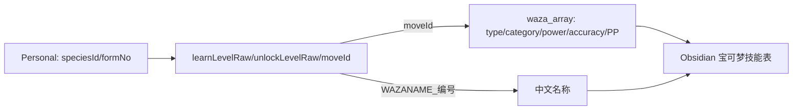

# Z-A v2.0.2 招式主表：902 条实测

> [!success] 从同一版本 ROM 提取，而非外部数据库推测
> 已从 `Unpack/v2.0.2/romfs/arc/data.trpfs/virtual/avalon/data/waza_array.bin`（91,924 字节）实际解析 **902 条 FlatBuffers Table**，输出真实的 `moveId`、属性、物理/特殊/变化类别、威力、命中原值、PP 原值。招式名来自本 ROM 的简体中文 `wazaname.dat/tbl`，并按 ID 校验。

## 一、下载什么

| 导出文件 | 行数 | 用途 |
|---|---:|---|
| `battle/ZA_move_stats_zh.csv` | 902 | 真正的招式主数据，含中文名、类型/分类/威力/命中/PP |
| `battle/ZA_move_fields_raw.csv` | 902 | 未解释字段的 vtable 下标、文件偏移和原始字节 |
| `names/ZA_move_names_zh.csv` | 921 | 游戏内 WAZANAME 中文消息 |
| `battle/ZA_levelup_learnsets_zh.csv` | 20,234 | 按物种/形态配置的学习与解锁等级 |
| `_audit/ZA_core_dex_manifest.json` | — | `waza_array.bin` SHA-256 和来源文件大小 |

完整脚本：`scripts/Export-ZA-CoreDex.py`；数据所在目录：`virtual_converted/_tables/`。

> [!warning] 数量不能混同
> 招式消息表有 921 条名称文本，招式主数据有 **902 条不同 moveId**，ID 范围包含 0～900 及 920。不能把第 901 行自动认为 `moveId=901`，也不能认为文本数就是可实际施放招式数。脚本按真实 `moveId` 关联名称。

## 二、原生 FlatBuffers 字段

| field 编号 | 二进制类型 | CSV | 本轮解释 |
|---:|---|---|---|
| 0 | u16 | `moveId` | 数字 ID |
| 2 | u8 | `typeId / typeZh` | 属性值 0～17 |
| 4 | u8 | `categoryId / categoryZh` | 0=变化，1=物理，2=特殊 |
| 5 | u8 | `powerRaw` | 原始威力；真实伤害还受程序计算影响 |
| 6 | u8 | `accuracyRaw` | 原始命中；**101 是特殊编码** |
| 7 | u8 | `ppRaw` | PP 初始配置 |
| 其他 | 待研究 | `presentFieldsJson` | 用原始字段索引和字节保留更多证据 |

`field N` 是 FlatBuffers vtable 的字段序号，不是 ARM64 指令偏移。`binaryTableOffset` 是 `waza_array.bin` 内文件字节偏移，不是 `main+RVA`。原始字段表中的 `rawBytes4` 是从每个字段位置起截取**最多 4 个相邻字节**，有可能包含后一个字段的数据，因此不能把每个 `rawBytes4` 都理解为当前字段的 32 位整数。

## 三、已校验的真实招式

| moveId | 名称 | 属性 | 类别 | 威力 | 命中原值 | PP |
|---:|---|---|---|---:|---:|---:|
| 1 | 拍击 | 一般 | 物理 | 40 | 100 | 35 |
| 2 | 空手劈 | 格斗 | 物理 | 50 | 100 | 25 |
| 33 | 撞击 | 一般 | 物理 | 40 | 100 | 35 |
| 45 | 叫声 | 一般 | 变化 | 0 | 100 | 40 |
| 53 | 喷射火焰 | 火 | 特殊 | 90 | 100 | 15 |
| 75 | 飞叶快刀 | 草 | 物理 | 55 | 95 | 25 |
| 94 | 精神强念 | 超能力 | 特殊 | 90 | 100 | 10 |

多种不同属性和分类的招式与已知值互相对照，可以确定本轮读取的六个字段具有高度一致性。属性 ID 到名称的解释仍应在未来与游戏代码的类型枚举核对。招式效果、伤害公式、Plus 强化、冷却与范围等**未因此完全还原**。

## 四、命中 101、威力 0 与特殊效果

实测 `accuracyRaw=101` 有 **285 条**。它很可能标志该招式有非普通命中检查规则，但它**不是 101% 命中率**。CSV 里把这种行单独标记 `accuracyKind=special_value_101`，没有悄悄改成 100。

同样，`powerRaw=0` 的变化类招式并不意味着不能产生效果；`ppRaw` 是主表的配置，不是战斗剩余 PP；仅凭 `categoryId=0` 不能判定最终伤害。研究 Z-A 的实时战斗、范围、蓄力、技能冷却还要继续分析剩余 FlatBuffers 字段和实际 ARM64 调用。

## 五、关联到每只宝可梦

使用 `battle/ZA_levelup_learnsets_zh.csv` 的 `moveId` 与 `battle/ZA_move_stats_zh.csv` 的 `moveId` 严格相等 JOIN；从而为 Personal 中的每条学习记录加上中文名称、属性、威力、命中和 PP。



例如妙蛙种子的 Personal 原始学习记录有 `moveId=33, learnLevelRaw=1, unlockLevelRaw=10`；关联后它是 **撞击、一般属性、物理、威力 40、命中 100、PP 35**。现在 [[22-宝可梦数据档案索引|364 张宝可梦笔记]] 已按这两张表关联，直接展示学习条件和招式主数据。

## 六、复现方法

```powershell
# 在 ZA_Resources 文档分支的仓库根目录
python scripts/Export-ZA-CoreDex.py --repo .
python scripts/Generate-ZA-PokemonObsidian.py --repo .
```

完整的 GitHub Actions 工作流 `za-real-data-export.yml` 已执行导出，并将 CSV 与 Markdown 保存到仓库当前分支。

### Python 示例

```python
from pathlib import Path
import csv
base = Path("Unpack/v2.0.2/romfs/arc/data.trpfs/virtual_converted/_tables")

def table(filename):
    with (base / filename).open(encoding="utf-8-sig", newline="") as f:
        return list(csv.DictReader(f))

learnsets = table("battle/ZA_levelup_learnsets_zh.csv")
moves = {r["moveId"]: r for r in table("battle/ZA_move_stats_zh.csv")}

for e in learnsets:
    if e["speciesId"] == "1" and e["formNo"] == "0":
        move = moves.get(e["moveId"])
        print(e["learnLevelRaw"], e["unlockLevelRaw"],
              e["moveZh"], move["typeZh"] if move else "缺少主表",
              move["powerRaw"] if move else "")
```

这里使用 `moves.get`，因为招式主表未覆盖每一个消息文本 ID，不能缺失后自动套用相邻行数据。

## 七、尚未完成的部分

- `waza_array` 的所有未命名字段，包括技能冷却、攻击范围、特殊效果和 Plus 相关配置。
- `TM` / 招式机兼容性、技能效果与动画调用关系。
- `learnLevelRaw=253/254` 的真实加载规则。
- 游戏运行时对命中编码 `101` 的判定，以及最终威力修正。

静态字段已经有 ROM 证据；动态机制请按 [[20-字段缺省值与证据级别]] 的 E4/E5 标准验证。相关：[[26-招式与技能学习数据专题]]、[[28-中文名称与原生学习表实测]]。
