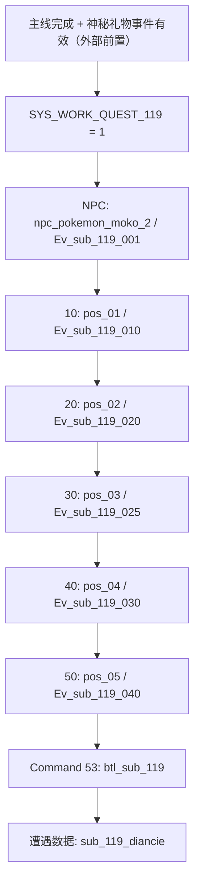
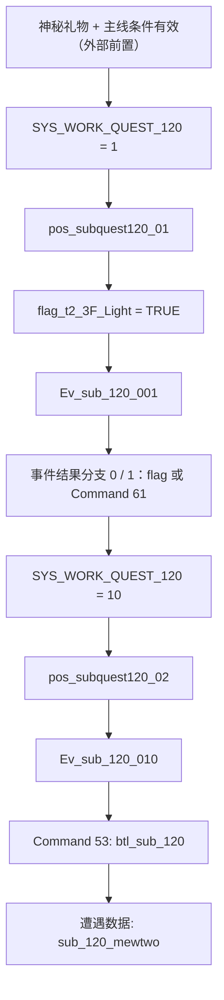
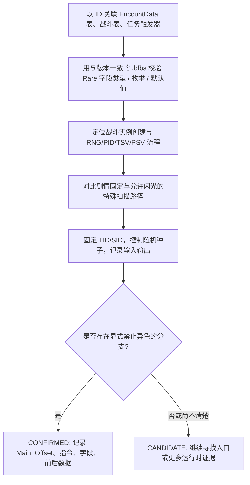

# Z-A 神兽锁闪与蒂安希、超梦触发事件：从资源到证据链

> [!important] 结论与证据等级
> - **CONFIRMED（静态数据）**：已经直接读取本仓库 v2.0.2 的四份原生 FlatBuffers，确认 EX1/EX2 的任务 ID、工作变量、阶段值、触发器条件、事件调用、战斗入口，以及对应的 70 级遭遇条目。
> - **CONFIRMED（字段原始值 + pkNX 映射）**：两只的遭遇条目均有 `Rare = 0x1FFFFFFF`，且本仓库 pkNX 的 `EncounterSlot9a.GetShiny` 与 `PrettyDumpUtil.GetShiny` 均将其解释为 **Shiny.Never**，因此可以将其认定为**数据配置层锁闪**。注意这不是未关联的 `RareType.NO_RARE = 1` 枚举。
> - **SUPPORTED（公开玩法资料）**：普通剧情静态神兽、蒂安希、超梦无法通过其对应的剧情遭遇获得异色。**并非全部神兽的所有遭遇方式都锁闪**，例如 DLC 的部分特殊扫描遭遇有例外。
> - **UNKNOWN（运行时）**：游戏 ARM64 原生实现如何读取 `Rare`、事件战斗如何转入 Pokémon 实例生成、最终如何处理异色 PID/标记，尚未通过本次运行时单步验证；本次已找到了 pkNX 侧编码解释，并不代表已经定位主程序分支。

## 1. 原始文件、版本和可复现性

本次仅作只读解析，不修改游戏二进制。所有路径相对 [969981/ZA_Resources](https://github.com/969981/ZA_Resources) 的 `master`：

| 证据层 | 源文件 | 实测大小 |
|---|---|---:|
| 任务定义 | `Unpack/v2.0.2/romfs/arc/data.trpfs/virtual/ik_event/bin/quest/sub_quest.bin` | 256,884 B |
| 蒂安希 EX1 | `.../ik_event/bin/trigger/sub/trigger_sub_0119.bin` | 2,256 B |
| 超梦 EX2 | `.../ik_event/bin/trigger/sub/trigger_sub_0120.bin` | 1,176 B |
| 实际遭遇配置 | `.../world/ik_data/field/pokemon/encount_data/encount_data/encount_data_array.bin` | 503,348 B |

完整 Git blob SHA、原始路径、逐条触发器 JSON、遭遇样本均保存在 [za-ex1-ex2-flatbuffers-evidence.json](za-ex1-ex2-flatbuffers-evidence.json)。可将该 JSON 视作 **本次静态读取的检查点**。

触发器结构来自仓库 pkNX：

- [TriggerTable.fbs](../../../tools/pkNX/FlatBuffers/ZA/Shared/Schemas/Shared/TriggerTable.fbs)：`TriggerTable.Table[] → Trigger.Start → TriggerCondition{Condition, Param, Activators[]}`。
- [ActivationCondition.fbs](../../../tools/pkNX/FlatBuffers/ZA/Shared/Schemas/Shared/ActivationCondition.fbs)、[ActivationConditionElement.fbs](../../../tools/pkNX/FlatBuffers/ZA/Shared/Schemas/Shared/ActivationConditionElement.fbs)、[ActivationConditionParam.fbs](../../../tools/pkNX/FlatBuffers/ZA/Shared/Schemas/Shared/ActivationConditionParam.fbs)。
- [TriggerCommand.fbs](../../../tools/pkNX/FlatBuffers/ZA/Shared/Schemas/Shared/TriggerCommand.fbs)：`Command:int` 和参数字符串向量。
- [EncountDataDBArray.fbs](../../../tools/pkNX/FlatBuffers/ZA/World/Schemas/Encount/EncountDataDBArray.fbs)：`DevNo / MinLevel / MaxLevel / Rare / ...`。

### 如何读取 FlatBuffers，而不是在二进制中直接搜字符串？

```text
文件偏移 0x00：root uoffset32
  -> 根 table（vtable 判断字段存在）
  -> 根字段 0：vector<Quest 或 Trigger 或 EncountDataDB>
      -> 每个元素是相对偏移 uoffset32
      -> 对应 table 的各字段（int、string、vector、nested table）
```

关键是 **uoffset32 相对于当前字段位置**，不是文件开头。某些 vtable 共享或位于文件后段，不能仅据位置假设表损坏。解码时需要校验：根地址、vtable 位置和长度、vector 长度及字符串边界。

## 2. EX 编号陷阱：0119 / 0120 ≠ UI 普通支线序号

`sub_quest.bin` 根表包含 **203 个记录**。通过 FlatBuffers 索引可找到：

| 数据位置 | 内部任务名 | 任务数值 ID | 状态变量 | 标题消息 Key | 阶段集合 |
|---|---|---:|---|---|---|
| vector[118] | `sub_0119` | **1001** | `SYS_WORK_QUEST_119` | `msg_subquest_title_119` | **1 → 10 → 20 → 30 → 40 → 50 → 255** |
| vector[119] | `sub_0120` | **1002** | `SYS_WORK_QUEST_120` | `msg_subquest_title_120` | **1 → 10 → 255** |

`sub_0119` 的图标/显示标记为 `espurr`（妙喵；结合官方剧情可对应 Mimi），`sub_0120` 对应字段为字符串 `null`。**任务内部编号 119/120、UI 中的 EX1/EX2、存档工作变量 119/120、任务数值 1001/1002 是四种不同层次，不能混成一个 ID。**

> [!note] 阶段 255
> `255` 出现在两条任务的最终阶段定义中；将它解释为「完成」是强候选，但要在保存数据的事件状态变化中确认。数字 `1/10/20/... ` 是静态记录的阶段值，不能据此直接断言每一步的 Lua 内部细节。

## 3. 蒂安希：EX1《像宝石一样闪耀》

### 3.1 解锁与地点

官方公布的玩家侧流程：通关主线 → 经神秘礼物领取蒂安希进化石（Diancite）与对应事件 → 前往帅哥侦探事务所 → 与妙喵 **Mimi（咪咪）** 对话 → 跟随它找到蒂安希。事件起始公告为 2025-11-06，见 [宝可梦官方网站](https://www.pokemon.com/us/pokemon-news/get-diancite-via-mystery-gift-and-diancie-in-pokemon-legends-z-a)。

静态文件没有直接证明「领取神秘礼物」的服务端校验全链；它明确给出了 **事件激活后的任务阶段、NPC、坐标点和战斗调用**。领取逻辑要另查 Mystery Gift 状态、事件全局 flag 与运行时的任务激活函数。

### 3.2 `trigger_sub_0119.bin` 实测 8 条顶层触发

下表 **条件和参数是从二进制实读**；`Command 22` 很可能是发起 Event，`53` 很可能是战斗入口，准确语义仍需匹配游戏的 command dispatch 实现。

| # | Start 条件（原生枚举/参数） | 激活要求 | Command ID / 原始参数 |
|---:|---|---|---|
| 0 | `1: npc_pokemon_moko_2` | `SYS_WORK_QUEST_119 = 1` | `22 Ev_sub_119_001` |
| 1 | `5: pos_subquest119_01` | `= 10` | `22 Ev_sub_119_010` |
| 2 | `5: pos_subquest119_02` | `= 20` | `22 Ev_sub_119_020` |
| 3 | `5: pos_subquest119_03` | `= 30` | `22 Ev_sub_119_025`；`116 False,FALSE` |
| 4 | `5: pos_subquest119_04` | `= 40` | `22 Ev_sub_119_030` |
| 5 | `5: pos_subquest119_05` | `= 50` | `22 Ev_sub_119_040`；**`53 btl_sub_119`** |
| 6 | `1: npc_main_detective` | `= 50` | `3 npc_main_detective,sub_119,msg_Ev_sub_119_030_talk_10,1` |
| 7 | `1: npc_pokemon_moko_2` | `= 50` | `3 npc_pokemon_moko_2,sub_119,msg_Ev_sub_119_030_talk_04,1` |

这里的 `npc_pokemon_moko_2` **实际为游戏内部 NPC 标识**，而不是通过名字就能推断种族；与官方的妙喵 Mimi 事件背景相互印证。NPC 对话、位置触发和战斗启动是多条不同路径，不应把「跟随咪咪」误写成单次触发就直接获赠蒂安希。



图中的 **箭头是按阶段值推测的流程顺序**，不是在本次静态文件内重建的完整 Lua 控制流；战斗表→Spawner→遭遇配置的精确静态映射现已通过真实原生数据闭合；**但战斗实际执行与实例生成的运行时调用路径尚待验证**。

### 3.3 遭遇表证据

`encount_data_array.bin` 中：

| 数据集索引 | 原始 ID | 内部种族号 | 等级范围 | 32 位 Rare 原值 |
|---|---|---:|---|---|
| DB[1] / row[69] | `sub_119_diancie` | **719（蒂安希）** | **70—70** | `0x1FFFFFFF` |
| DB[1] / row[70] | `sub_119_melecie_01` | 703（小碎钻） | 66—66 | `0x1FFFFFFF` |
| DB[1] / row[71] | `sub_119_melecie_02` | 703（小碎钻） | 66—66 | `0x1FFFFFFF` |

这支持「蒂安希与两只小碎钻一起参与事件战斗」的静态资源关联。注意 `sub_119_diancie` **只是遭遇数据 ID**；现已在实际战斗数据中找到 `btl_sub_119` → `id_sub119_01`，并在原生 Spawner 表中找到 `id_sub119_01` → `sub_119_diancie` 的精确字段引用。实例生成函数的真实调用路径仍需逆向。

## 4. 超梦：EX2《Project M》

### 4.1 触发条件与可观察状态

玩家侧流程：通关主线并领取相应神秘礼物事件 → 前往弗拉达利研究所（Lysandre Labs）→ 触发研究所设施事件并捕获超梦。更多任务条件可对照 [Bulbapedia EX2](https://bulbapedia.bulbagarden.net/wiki/Mission_(Legends:_Z-A))。文件里 **没有证明 Diancite 可替代超梦事件礼物**，两条应视为独立分发条件。

`trigger_sub_0120.bin` 实测 **4 条顶层触发**：

| # | Start 条件 | 激活要求 | Command ID / 原始参数 |
|---:|---|---|---|
| 0 | `5: pos_subquest120_01` | `SYS_WORK_QUEST_120 = 1` | `8 flag_t2_3F_Light,TRUE` → `22 Ev_sub_120_001` → `8 flag_Ev_sub_120_001_first,TRUE` |
| 1 | `10: Ev_sub_120_001,0` | `force_condition`, op=0 | `8 flag_Ev_sub_120_001,TRUE` |
| 2 | `10: Ev_sub_120_001,1` | `force_condition`, op=0 | `61 410.48,2.41,14,0` |
| 3 | `5: pos_subquest120_02` | `SYS_WORK_QUEST_120 = 10` | `22 Ev_sub_120_010` → **`53 btl_sub_120`** |

`force_condition`、`work_condition`、`flag_t2_3F_Light` 及所有位置参数均为 **原始字符串**。`61` 的四个浮点字符串很像坐标及朝向，须由 dispatch 校验，不能直接写成已证实的传送位置。



### 4.2 超梦遭遇数据

`encount_data_array.bin` 的 **DB[1] / row[72]**：

```yaml
Id: sub_120_mewtwo
DevNo: 150
MinLevel: 70
MaxLevel: 70
Rare_raw_uint32: 536870911
Rare_raw_hex: 0x1FFFFFFF
```

同一事件触发器和遭遇数据 ID 使用了 `sub_120` 命名体系。这是很强的静态关联，但 **战斗 ID → 战斗定义 → Spawner → 遭遇数据的静态链已核实，仍不可跳过 Spawner → 实例生成器的运行时验证** 的进一步验证。

## 5. 如何有证据地判定神兽「锁闪」？

### 5.1 必须分清三种东西

1. **物种**：`DevNo`，比如 `150` 超梦、`719` 蒂安希、`716/717/718` 哲尔尼亚斯/伊裴尔塔尔/基格尔德。锁闪通常依赖 **遭遇来源**，不是简单把某物种在全游戏一律锁死。
2. **生成配置**：`EncountData.Rare`、战斗/赠礼配置、固定 PID 或种子处理规则；具体作用需要追踪解释。
3. **实际运行结果**：创建 Pokémon 时是否强制异色无效（改变 PID、重新生成、直接设标记等），这才是机制层的决定性证据。

### 5.2 实测到的剧情遭遇样本

| encounter Id | DevNo | 等级 | `Rare` 原始 32 位 |
|---|---:|---:|---|
| `m10_x` | 716 | 75 | `0x1FFFFFFF` |
| `m10_y` | 717 | 75 | `0x1FFFFFFF` |
| `ect_boss_0718_01` | 718 | 84 | `0x1FFFFFFF` |
| `sub_119_diancie` | 719 | 70 | `0x1FFFFFFF` |
| `sub_120_mewtwo` | 150 | 70 | `0x1FFFFFFF` |
| `Ev_sub_202_010` | 720 | 60 | `0x1FFFFFFF` |
| `Ev_sub_201_011` | 721 | 80 | `0x1FFFFFFF` |

**已对照源码核实的编码含义：** [EncounterSlot9a.cs](../../../tools/pkNX/pkNX.WinForms/Subforms/Gen9a/Map/Exports/EncounterSlot9a.cs) 的 `GetShiny(int valueRare)` 明确将 `0x1FFFFFFF` 对应到 `Shiny.Never`、`0x2FFFFFFF` 对应到 `Shiny.Always`、`0x3FFFFFFF` 对应到 `Shiny.Random`；另见 [GameDumper9a.cs](../../../tools/pkNX/pkNX.WinForms/Dumping/Gen9a/GameDumper9a.cs) 的 `PrettyDumpUtil.GetShiny`。**这是 pkNX 的配置映射证据，不是游戏本体反汇编后的代码分支证据。** `RareType.fbs` 中另有 `DEFAULT=0, NO_RARE=1, RARE=2`，不可与此 32 位遭遇配置混用。

| Rare 原始值 | pkNX 解释 | 当前 v2.0.2 原始表条目数 |
|---|---|---:|
| `0x1FFFFFFF` | `Shiny.Never`：禁止异色 | **281** |
| `0x2FFFFFFF` | `Shiny.Always`：固定异色 | **1** |
| `0x3FFFFFFF` | `Shiny.Random`：随机异色 | **1,684** |

**交叉对照：** 唯一 `Shiny.Always` 的记录为 `ect_a0102_w01_v01_z179_Qst074`（内部种族 179，Lv.11）；普通野生示例 `ect_a0201_w01_v01_z225` 为 `Shiny.Random`。这三类计数总和为 1,966。

**原始字节复核（均为文件相对偏移，非 RAM）：**

| 遭遇 Id | FlatBuffers table 起始偏移 | Rare 字段文件偏移 | 四字节原值（小端） |
|---|---|---|---|
| `m10_x` | `0x74D0C` | `0x74D24` | `FF FF FF 1F` |
| `m10_y` | `0x74C58` | `0x74C70` | `FF FF FF 1F` |
| `ect_boss_0718_01` | `0x795F0` | `0x7960C` | `FF FF FF 1F` |
| `sub_119_diancie` | `0x733FC` | `0x73414` | `FF FF FF 1F` |
| `sub_120_mewtwo` | `0x73244` | `0x7325C` | `FF FF FF 1F` |

**读取方法**：从文件头 `root uoffset32` 开始，依次展开 `EncountDataDBArray.Table[] → EncountDataDB.Table[] → EncountData`；按 `Id` 定位记录。通过 table 开头的有符号 vtable 偏移定位字段 6 的实际偏移（不应假定每条记录都固定为 table+24），读取 little-endian `int32` 即得 `Rare`。例如超梦 table 起始 `0x73244`，field 6 在 `+0x18`，因此 `0x7325C` 的原值 `FF FF FF 1F` 即 `0x1FFFFFFF`。

公开资料汇总对剧情静态遇敌的锁闪判断，以及特殊扫描（Latios、Latias、Cobalion、Terrakion、Virizion）可能出现异色的例外，可参见 [RotomLabs 的 Z-A 异色说明](https://rotomlabs.net/legends-z-a/shiny-rates)、[Serebii](https://www.serebii.net/legendsz-a/sidemissions.shtml)。这只是支持玩法事实，**不替代代码级证明**。

### 5.3 推荐的可复现锁闪验证



建议至少分别追踪 `sub_119_diancie`、`sub_120_mewtwo`、`m10_x` 与一条明确可闪的遭遇，将以下项逐条写日志：

```text
game_version, build_id, encounter_id, source_table, source_row
rng_seed, trainer_tid, trainer_sid, before_pid, after_pid
shiny_xor_or_game_criterion, Rare_raw, forced_branch
main_relative_pc, lr, field_ptr, value_before, value_after
result_shiny, result_species, result_level, save_readback
```

如果仅连刷许多次未见闪光，即使样本很多，也**不能代替生成器中「拒绝异色」的代码证据**。还应区分 Boss 战、固定剧情获得、野外刷新及特殊扫描：**不能把战斗中有闪光特效与最终可合法捕获的异色混淆**。

## 6. 三条证据链如何闭合？

| 目标 | 现已完成 | 还需做什么 |
|---|---|---|
| **EX1 任务** | `sub_0119 / 1001 / SYS_WORK_QUEST_119`，完整 8 条触发器 | 寻找 Mystery Gift→任务启用条件与 `Ev_sub_119_*` Lua |
| **EX2 任务** | `sub_0120 / 1002 / SYS_WORK_QUEST_120`，完整 4 条触发器 | 寻找 Mystery Gift→任务启用条件与 `Ev_sub_120_*` Lua |
| **关联遭遇** | Diancie 719/70、Mewtwo 150/70，`Rare=Shiny.Never`；战斗名经 Spawner 精确关联对应 EncountData | Spawner → 原生实例生成器的动态调用证据 |
| **锁闪机制** | 原始 FlatBuffers `Rare` 已核对为 pkNX 的 `Shiny.Never / Always / Random` 编码；全表三类计数与原始偏移验证 | 游戏 ARM64 生成器具体处理方式、函数调用链、对照运行时判定 |

> [!warning] 请勿做过度结论
> 本次证实的是静态事件配置，不是已验证的 ARM64 锁闪指令或补丁地址；**没有找到并验证任何 `main+offset` 的强制非闪判断**，也没有证明单靠改 `Rare` 原始值就可以正常产生异色。

## 7. 后续分析建议

优先处理 `btl_sub_119` 与 `btl_sub_120` 的战斗配置，以及对应的 `Ev_sub_119_*/Ev_sub_120_*` Lua 脚本。通过对 `EncountData.Id` 的交叉引用追踪到具体实例创建器后，再将静态字段与运行时分支对账。完成后应把 `UNKNOWN` 升级为 `CONFIRMED`，并附日志、版本 Build ID、准确文件 SHA 与反例验证。

## 8. 参考入口

- [本仓库 v2.0.2 原生触发、任务、遭遇证据 JSON](za-ex1-ex2-flatbuffers-evidence.json)
- [官方蒂安希事件说明（2025-11-06）](https://www.pokemon.com/us/pokemon-news/get-diancite-via-mystery-gift-and-diancie-in-pokemon-legends-z-a)
- [Bulbapedia：Legends Z-A 任务编号与 EX 支线](https://bulbapedia.bulbagarden.net/wiki/Mission_(Legends:_Z-A))
- [Bulbapedia：游戏内特殊遭遇](https://bulbapedia.bulbagarden.net/wiki/List_of_in-game_event_Pok%C3%A9mon_in_Pok%C3%A9mon_Legends:_Z-A)
- [RotomLabs：异色遭遇与例外](https://rotomlabs.net/legends-z-a/shiny-rates)

返回 [[README]] 或 [研究目录](README.md)。

## 9. 原生 ARM64 运行时排查补充（2026-11-06）

实际解析 `ik_event/bin/event_wild_battle_data/wild_btl_data_global.bin`，已找到 `btl_sub_119` 和 `btl_sub_120` 的战斗记录、对象 ID 和事件名。v2.0.2 主程序 ELF 经 SHA-256 核验后扫描出 5 处完整 `0x1FFFFFFF` 立即数，Capstone 反汇编显示均有独立的计算用途，**不能当作 Rare 消费或锁闪分支**。详见 [原生锁闪静态审计](za-rare-arm64-runtime-chain-audit.md) 与 [5 处实际反汇编](za-rare-arm64-exact-sites.md)。

事件战斗到 `EncountData` 的引用链，以及实际 PID/锁闪判断仍未验证。**不提供虚构的 `main+offset`。**

## 10. Spawner 交叉引用真实验证（2026-11-06）

已通过 [跨表解析脚本](../../../scripts/Trace-ZA-EX-Spawner.py) 读取 1,401,772 字节的 `pokemon_spawner_data_array.bin`，共 13 组数据库、2,211 条 Spawner 记录（2 项合成测试和真实文件读取通过）。

| 来源战斗 | Battle.Field1 | Spawner DB / Row | Spawner.Encounters[].EncountDataId |
|---|---|---|---|
| `btl_sub_119` | `id_sub119_01` | 11 / 37 | `sub_119_diancie`、`sub_119_melecie_01`、`sub_119_melecie_02` |
| `btl_sub_120` | `id_sub120_01` | 11 / 38 | `sub_120_mewtwo` |

两条完全一致的源 ID 通过原生字段真实关联，不是字符串前缀推断；详见 [原始交叉引用 JSON](za-ex1-ex2-spawner-crosswalk.json) 与 [ARM64 静态研究审计](za-rare-arm64-runtime-chain-audit.md)。**配置链已经闭合，游戏原生实例生成器、PID 处理以及实际锁闪执行地址仍为 UNKNOWN。**
