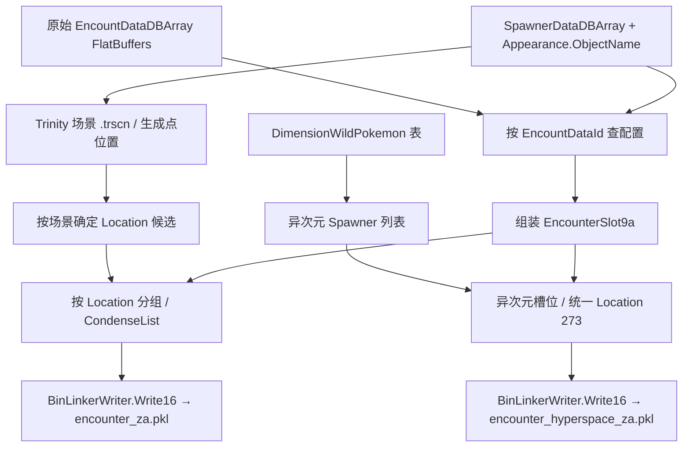

# Z-A 遭遇 PKL：从游戏资源到 PKHeX，以及如何读取和修改

> [!important] 核心结论
> **PKL 只是文件后缀，不是 Python 的 pickle。** PKHeX Z-A 野生遭遇数据采用小端 **`za` BinLinker16**：每个 Location 一个区域，每条 EncounterSlot 固定 **8 字节**。使用 `pickle.load` 或直接编辑十六进制偏移均不合适。
>
> 本文把三个互不等同的操作分开：① 从**原生资源 + pkNX**重建遭遇槽位；② 从已导出的 `*_slot_sets.json` 打包 PKL；③ 解码/编辑/回打包**已有 PKL**。完成③**不代表**已经完成①，编辑 PKL 也不会修改游戏实际的遭遇系统。

## 1. 证据与对应源代码

| 环节 | 仓库内代码 / 原始输入 | 作用 |
|---|---|---|
| 原始 FlatBuffers 数据 | `Unpack/v2.0.2/romfs/arc/data.trpfs/virtual/world/ik_data/field/...` | 生成器配置、物种/等级、场景、异次元组合 |
| Schema | `tools/pkNX/FlatBuffers/ZA/.../*.fbs` | 确定 FlatBuffers 字段、偏移 |
| 场景生成点 | [SpawnSceneSimulation.cs](../../tools/pkNX/pkNX.WinForms/Subforms/Gen9a/Map/Dumping/SpawnSceneSimulation.cs) | 从 Trinity `.trscn` 获取名称和 3D 坐标 |
| 场景与 Spawner 关联 | [SimulatedAreaSet.cs](../../tools/pkNX/pkNX.WinForms/Subforms/Gen9a/Map/Exports/SimulatedAreaSet.cs) | 对 `AppearanceSpawnerObjectInfoList.ObjectName` 作精确关联 |
| PKL 8 字节槽位写入 | [EncounterSlot9a.cs](../../tools/pkNX/pkNX.WinForms/Subforms/Gen9a/Map/Exports/EncounterSlot9a.cs) | 种族转号、等级、头目、异色；写出 u16/byte |
| PKL 区域聚合 | [EncounterArea9a.cs](../../tools/pkNX/pkNX.WinForms/Subforms/Gen9a/Map/Exports/EncounterArea9a.cs) | 合并重叠等级区间 |
| 普通/异次元正式输出 | [SpawnRipper9a.cs](../../tools/pkNX/pkNX.WinForms/Subforms/Gen9a/Map/SpawnRipper9a.cs) | `DumpSceneToPickle` 与 `ExportHyperspacePickle` |
| PKHeX 官方读法 | [EncounterArea9a.cs（PKHeX）](https://github.com/kwsch/PKHeX/blob/master/PKHeX.Core/Legality/Encounters/Templates/Gen9a/EncounterArea9a.cs) | `areaData[0..2]` 为 Location，`areaData[4..]` 每 8B 一槽 |
| 原始完整审计 | [za_encounter_crosswalk.py](../../scripts/encounters/za_encounter_crosswalk.py) | Spawner→Encounter→场景，及 PKHeX 槽覆盖检查 |
| pkNX JSON → PKL | [za_pkl_tool.py](../../scripts/encounters/za_pkl_tool.py) | 打包 t1/t2/t3 JSON 的普通野生 PKL |
| **已有 PKL → JSON → 新 PKL** | [za_pkl_codec.py](../../scripts/encounters/za_pkl_codec.py) | 无损读写、定点修改、差异与 SHA 保护 |
| 测试 | [test_za_pkl_tool.py](../../tests/test_za_pkl_tool.py) / [test_za_pkl_codec.py](../../tests/test_za_pkl_codec.py) | 合成样本与实际 PKHeX 原文件回环验证 |

相关：[[../research/v2.0.2/za-encounter-resource-formats|原生数据二进制结构]]、[[../research/v2.0.2/za-encounter-crosswalk-v2.0.2|Spawner 与场景全量对账]]、[[../research/v2.0.2/za-spawn-gap-triage-runtime-evidence|58/586 缺口与事件链]]。

## 2. 原始资源如何一步步变成 PKL？

核心原生文件来自 `virtual/`：

| 原始文件 | v2.0.2 实读规模 | 作用 |
|---|---:|---|
| `pokemon/encount_data/encount_data/encount_data_array.bin` | 503,348B / **1,966** EncountData | `Id`、`DevNo`、形态、性别、等级、`Rare`、头目概率/等级增加、激活条件 |
| `pokemon_spawner/pokemon_spawner_data/pokemon_spawner_data_array.bin` | 1,401,772B / **2,211** Spawner | 对象名、`EncountDataInfoList[].EncountDataId`、抽选权重、等级加成、条件 |
| `spawner_transform_data/pokemon_spawner_transform/pokemon_spawner_transform_array.bin` | 148,696B / **2,108** Transform | 命名生成点与 Transform 辅助关联，不等同地点编号 |
| `dimension/dimension_wild_pokemon/dimension_wild_pokemon/dimension_wild_pokemon_array.bin` | 89,264B / **1,500** 引用 | 异次元 Type、Rank、Pattern、SpawnerDataId |
| `world/ik_scene/field/area/**/*.trscn` | 多场景 | Trinity SceneObjectTemplate 中的生成点名称、Translation XYZ |

**静态数据转换链：**



### 2.1 普通野生（`encounter_za.pkl`）

1. 使用原始 `.fbs` 解析二进制。不是通过字符串匹配猜测种族和等级。
2. 根据 `SceneInfo9a.ScenePathsT1/T2/T3` 读取场景 Trinity ObjectTemplate；找到 `pokemon_spawner_box_object`、`pokemon_spawner_sphere_object`、`pokemon_spawner_point_object`，取得 `ObjectTemplateName`、Translation XYZ。
3. 通过 `AppearanceSpawnerObjectInfoList.ObjectName` 与场景生成点名精确匹配到 Spawner，再根据 `EncountDataInfoList.EncountDataId` 精确定位 EncountData。
4. 为每个点决定 Location：普通 T1 根据 pkNX `ManualPositionRip` 位置表映射；T2 实验室为 **234**，T3 下水道为 **235**。**`t1_i007a` 的三个场景点存在局部坐标系异常；本仓库审计工具已将其地点标记 UNKNOWN，不能沿用误配出的 202。** 只有获得可信 Location 的配置才应写入正式生成 PKL。
5. 按真实代码 `EncounterSlot9a.AddSlots`：`DevNo` 经过 `SpeciesConverterZA.GetNational9` 转成全国编号；`FormNo`、`Sex` 和 `MinLevel/MaxLevel` 赋值；`Rare` 使用三态映射；`OyabunProbability < 100` 时加入普通槽位，`> 0` 时加入头目槽位，头目同时增加 `OyabunAdditionalLevel`。
6. 按 Location 分组，`CondenseList` 仅在物种/形态/性别/Alpha/Shiny 相同且**等级区间相交**时合并。编辑已有 PKL 时则**不自动合并、不改变顺序**，以保证字节级回环。
7. 调用 pkNX `WritePickle`，底层 `BinLinkerWriter.Write16(result, "za")`，输出 `encounter_za.pkl`。`WritePickleWithoutLocations` 是**另行输出同名 `.bin`** 用于查看无地点的连续槽位，不是覆盖 `.pkl`。

### 2.2 异次元（`encounter_hyperspace_za.pkl`）

`SpawnRipper9a.ExportHyperspacePickle` 不简单遍历常规 T1/T2/T3 场景。它按 `DimensionWildPokemon` 的引用选取随机 Spawner 集合，并补充 `ect_zdm40*` 特殊扭曲附属遭遇；对应 `EncounterSlot9a.AddSlots(..., hyperspaceBoost: true)` 会使用 `EncountDataInfo.AdditionalLevel` 给等级加成。

所有槽位统一 Location **273**；PKL 本身不保留 Type、Rank、Pattern、LotteryWeight 等抽选权重。pkNX 对特殊 Boss 的固定配置也会走独立处理，不能一律塞入野生 PKL。

> [!warning] 当前完成范围
> 已实读原始数据、交叉关联 Spawner 与 Encounter、对照 PKHeX 官方 PKL，并提供 JSON→PKL 打包器。但**尚不能声称已从全量 v2.0.2 原始资源无差异重建出官方两份 PKL**；当前 58 场景、586 Spawner 缺口及特殊 Location 候选仍需要逐源核查。本文记录可复现的 pkNX 生成链，不把已有官方 PKL 误标成“自己从 RomFS 提取成功”。

## 3. 实际 PKL 二进制结构

文件整体：

```text
offset  size      内容
0x00    2         ASCII "za" (0x7A 0x61)
0x02    2         little-endian ushort AreaCount
0x04    2*(N+1)   各区域绝对文件偏移表（含结束哨兵）
...               Area 0 : [Location u16][Reserved u16=0][8B slots...]
...               Area 1 ...
...               Area N-1 ...
EOF               offsets[N] == 文件总长度
```

每个 Slot 的 **8B 小端结构**（与 PKHeX `EncounterArea9a.ReadSlots` 一致）：

| slot+偏移 | C 类型 | JSON 字段 | 含义 |
|---:|---|---|---|
| 0 | `uint16_le` | `Species` | 全国图鉴号 |
| 2 | `uint8` | `Form` | 形态 |
| 3 | `uint8` | `Gender` | 0 ♂、1 ♀、2 无性别、255=随机/未限定 |
| 4 | `uint8` | `LevelMin` | 最低等级 |
| 5 | `uint8` | `LevelMax` | 最高等级 |
| 6 | `uint8` | `IsAlpha` | 0 否、1 是 |
| 7 | `uint8` | `Shiny` | 0 Random、1 Never、2 Always |

注意两个枚举不能混用：

- 原始 EncountData.`Rare`：`0x1FFFFFFF` Never、`0x2FFFFFFF` Always、`0x3FFFFFFF` Random。
- pkNX `Shiny` 枚举：Random=0、Always=1、Never=2；**PKL 字节**：Random=0、Never=1、Always=2。

示例（**合成测试数据，不是实际某个游戏遭遇**）：

```text
7A 61 01 00   08 00 14 00   0C 00 00 00   19 00 00 FF 05 06 00 00
|  za  |N=1 |  start=8 end=20 | loc=12 reserved=0 | species=25  F=0 G=FF Lv5–6 Alpha0 Shiny0
```

### 官方原文件基线（从 PKHeX 实际字节验证）

| 文件 | 文件大小 | 地点数 | 槽位数 | 头目槽位 | Shiny Random/Never/Always |
|---|---:|---:|---:|---:|---:|
| `encounter_za.pkl` | 9,568 B | 99 | 1,121 | 366 | 1110 / 10 / 1 |
| `encounter_hyperspace_za.pkl` | 9,996 B | 1（273） | 1,248 | 624 | 1248 / 0 / 0 |

真实 PKHeX 路径：[Gen9 wild encounter resources](https://github.com/kwsch/PKHeX/tree/master/PKHeX.Core/Resources/legality/wild/Gen9)。

## 4. Windows 读取、导出 JSON 与恢复（无需 C#）

所有命令在仓库根目录执行。安装 Python 3.10+，仅使用标准库，**不需要** `pip install pickle`。

先创建工作目录并下载两份上游官方样本（也可以改为自己的 PKL）：

```powershell
$base = "https://raw.githubusercontent.com/kwsch/PKHeX/master/PKHeX.Core/Resources/legality/wild/Gen9"
$work = ".\.za-work\pkl-edit"
New-Item -ItemType Directory -Force $work | Out-Null
Invoke-WebRequest "$base/encounter_za.pkl" -OutFile "$work\encounter_za-original.pkl"
Invoke-WebRequest "$base/encounter_hyperspace_za.pkl" -OutFile "$work\encounter_hyperspace_za-original.pkl"
```

**检查基本结构 / 读取单个地点：**

```powershell
py -3 scripts/encounters/za_pkl_codec.py inspect "$work\encounter_za-original.pkl"
py -3 scripts/encounters/za_pkl_codec.py inspect "$work\encounter_za-original.pkl" --location 12
py -3 scripts/encounters/za_pkl_codec.py inspect "$work\encounter_hyperspace_za-original.pkl" --location 273
```

**无损导出全部槽位为可编辑 JSON：**

```powershell
py -3 scripts/encounters/za_pkl_codec.py export "$work\encounter_za-original.pkl" --out "$work\encounter_za.json"
```

其中单个位置与 Slot 例如：

```json
{
  "format": "PKHeX-ZA-BinLinker16",
  "format_version": 1,
  "source_sha256": "原文件实际SHA256（自动生成，勿手改）",
  "source_byte_size": 9568,
  "areas": [
    {
      "Location": 12,
      "Slots": [
        {
          "Species": 16,
          "Form": 0,
          "Gender": 255,
          "LevelMin": 5,
          "LevelMax": 8,
          "IsAlpha": false,
          "Shiny": "Random"
        }
      ]
    }
  ]
}
```

以上 JSON 是**字段形状示例**，省略了实际的其他区域及 Slot；`source_sha256` 占位符也不是有效 HASH。实际导出的完整 JSON 可以直接重新打包，**不能把这个精简示例直接用于恢复官方 PKL**。

**无修改回打包与 SHA 校验：**

```powershell
py -3 scripts/encounters/za_pkl_codec.py import "$work\encounter_za.json" --source-pkl "$work\encounter_za-original.pkl" --out "$work\encounter_za-roundtrip.pkl"
Get-FileHash "$work\encounter_za-original.pkl" -Algorithm SHA256
Get-FileHash "$work\encounter_za-roundtrip.pkl" -Algorithm SHA256
py -3 scripts/encounters/za_pkl_codec.py diff "$work\encounter_za-original.pkl" "$work\encounter_za-roundtrip.pkl"
```

预期两个 SHA-256 **完全相同**，`diff.byte_identical=true`，添加/删除槽位数为 0。失败就停止，不进行编辑或下游替换。编辑器保留原始区域及槽位顺序，故与会自动合并范围的生成器不同。

## 5. 修改 PKL（两种方法）

### 方法 A：编辑 JSON 后重新打包（适合批量修改）

1. 用 VS Code / Obsidian / 文本编辑器打开 `encounter_za.json`。
2. 找 `areas` 中所需的 `Location`，再修改 `Slots` 内的 `Species` / `Form` / `LevelMin` / `LevelMax` / `IsAlpha` / `Shiny`。
3. `Shiny` 只用 `"Random"`、`"Never"`、`"Always"`。`Gender=255` 表示不限定，不能把它变成任意无意义的数。
4. 保留 `format`、`format_version`、`source_sha256`、`source_byte_size`；不要把旧的来源 SHA 改成新 PKL 的 SHA。
5. 只输出到**新文件名**，不覆盖原文件：

```powershell
py -3 scripts/encounters/za_pkl_codec.py import "$work\encounter_za.json" --source-pkl "$work\encounter_za-original.pkl" --out "$work\encounter_za-modified.pkl"
py -3 scripts/encounters/za_pkl_codec.py diff "$work\encounter_za-original.pkl" "$work\encounter_za-modified.pkl" --out "$work\changes.json"
```

文件名已存在时会拒绝覆盖；多次试验请更换输出名，保留原始文件备份。

### 方法 B：命令行修改指定槽位（适合单点）

先用 `inspect --location 12` 查到 Slot 的顺序；以下只作为**修改命令示例**：

```powershell
py -3 scripts/encounters/za_pkl_codec.py patch "$work\encounter_za-original.pkl" --out "$work\encounter_za-patched.pkl" --location 12 --index 0 --shiny Never
py -3 scripts/encounters/za_pkl_codec.py diff "$work\encounter_za-original.pkl" "$work\encounter_za-patched.pkl"
```

`--index` 从 **0** 开始，`--shiny Never` 会将指定槽位改为禁止异色。也支持 `--species`、`--form`、`--gender`、`--level-min`、`--level-max`、`--alpha true|false`。仅在你有权限且理解用途的独立 PKHeX 测试环境中使用。

**回滚**不需要专用恢复指令：保留的 `encounter_za-original.pkl` 从未被改动；删除或弃用 `*-modified.pkl`，重新使用原件即可。工具使用独占创建方式，避免脚本意外覆盖原 PKL。

### 为什么不推荐十六进制直接编辑？

BinLinker16 头部包含地点数量和全文件绝对偏移表。增删 Slot 会使后续偏移整体变化，手改极容易破坏区域边界。编码器会同时更新偏移表、检查 `u16` 溢出，并重读验证输出。普通与异次元都使用同一工具和 `za` 格式。

## 6. 从 pkNX 详细数据重新生成普通遭遇 PKL

如果已经按照 [SpawnRipper9a.cs](../../tools/pkNX/pkNX.WinForms/Subforms/Gen9a/Map/SpawnRipper9a.cs) 导出了 `spawner/t1_slot_sets.json`、`t2_slot_sets.json`、`t3_slot_sets.json`，可以不用 C# 将**这些已整理好的 pkNX JSON**打包为 `encounter_za.pkl`：

```powershell
py -3 scripts/encounters/za_pkl_tool.py --build .\spawner\t1_slot_sets.json .\spawner\t2_slot_sets.json .\spawner\t3_slot_sets.json --out .\.za-work\pkl-edit\encounter_za-from-json.pkl
py -3 scripts/encounters/za_pkl_tool.py --inspect .\.za-work\pkl-edit\encounter_za-from-json.pkl
```

`za_pkl_tool.py` 与 `za_pkl_codec.py` 区别：

| 工具 | 入口数据 | 是否会合并等级区间 | 主要用途 |
|---|---|---|---|
| `za_pkl_tool.py` | pkNX `*_slot_sets.json` | **是** | 把生成器的源槽位整理为 PKL |
| `za_pkl_codec.py` | 已有 `za` PKL 或其直接导出的 JSON | **否** | 无损查看、修改已有 PKL 和回打包 |
| `za_encounter_crosswalk.py` | v2.0.2 原始 FlatBuffers + 场景 + 官方 PKL | 不生成 PKL | 找到原始关联、PKL 覆盖及待验证缺口 |
| `za_gap_triage.py` / `za_trigger_battle_audit.py` | 原始 Spawner / Battle / Trigger | 不生成 PKL | 解释未匹配生成器和事件战斗关系 |

异次元仍需 pkNX `ExportHyperspacePickle` 的完整来源或独立实现同等算法，不能把普通 PKL 改成 Location 273 就冒充完整异次元遭遇表。

## 7. 自动化验收要求

1. 合成测试：非法头部、损坏 offset、性别和异色枚举、重复地点、范围错误、长度溢出；以及从 JSON 导出再回写。
2. 官方二进制原文件回环：两份 PKHeX PKL → JSON → 新 PKL，SHA-256 和字节完全一致；不把官方文件提交进仓库。
3. 对任何真正修改过的 PKL，`diff` 显式记录变更前后 Location/Species/等级/Alpha/Shiny，默认禁止覆盖。
4. 如果要发布给 PKHeX 使用，需另行在同一 PKHeX 版本进行实际加载/合法性回归；静态格式正确**不等于**新编辑的遭遇真实合法或能在游戏中获得。
5. 原生数据、代码提交与输出产物分开；不覆盖原 RomFS、不提交密钥或个人存档。

测试入口：

```powershell
py -3 -m unittest discover -s tests -p test_za_pkl_tool.py -v
py -3 -m unittest discover -s tests -p test_za_pkl_codec.py -v
```

相关 CI：[za-encounters.yml](../../.github/workflows/za-encounters.yml)。
